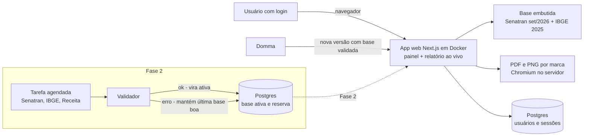
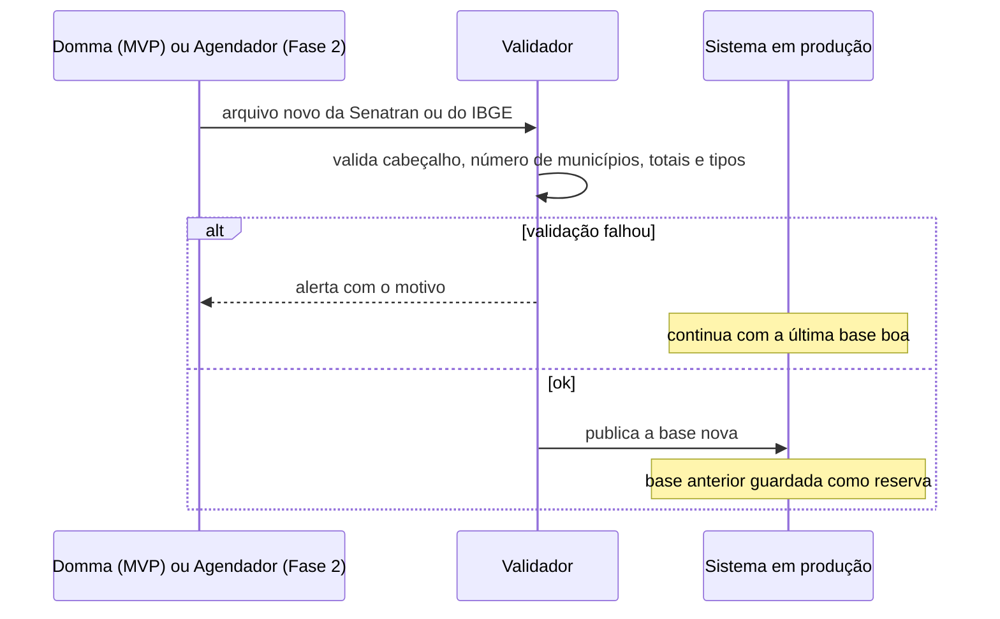
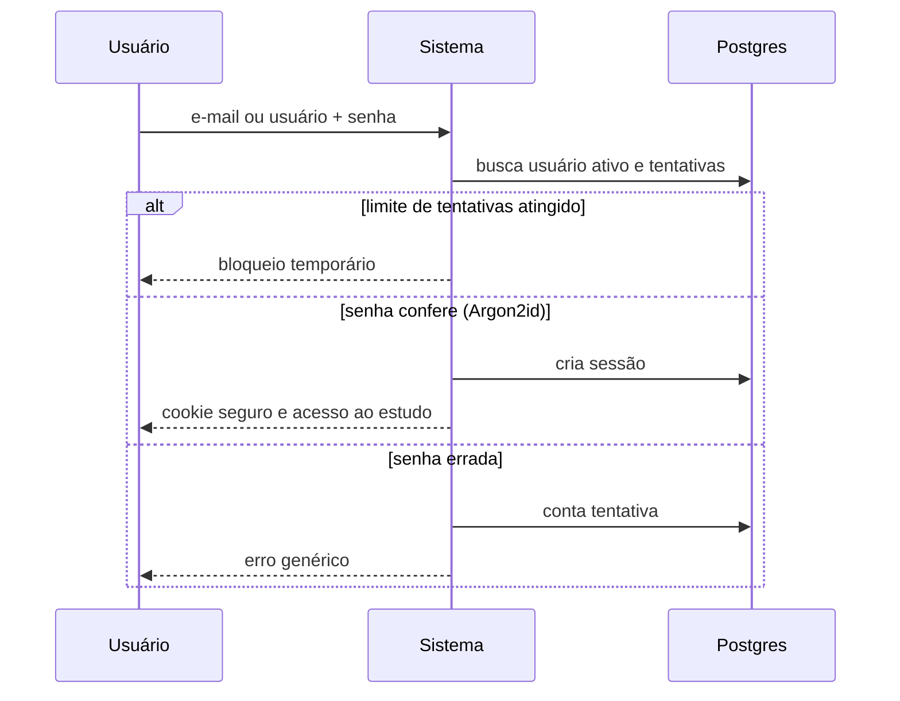
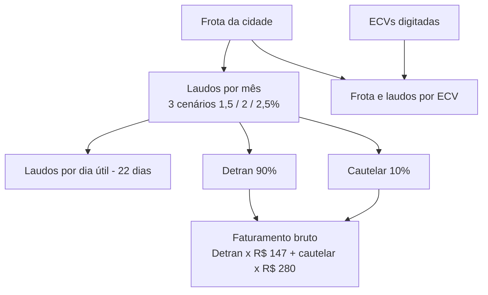
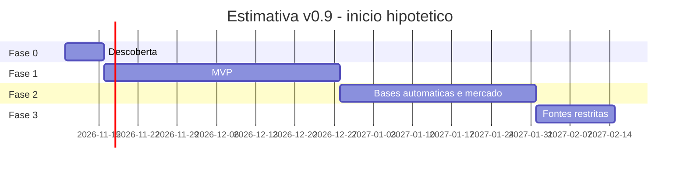

# Escopo — Gerador de Estudo de Praça v2 | Auto Visão & Royal

**Cliente interno:** Otávio Marques — Domma Tecnologia
**Data:** 29/10/2026 · **Versão do documento:** 2.0 — **escopo final** (cópia da v1.6 guardada antes da mudança)
**Natureza:** escopo final do MVP. O MVP está implementado localmente pela Domma (`/home/box/domma/estudo-praca-v2`, versão 0.2.0, testes passando); nada foi implantado nem publicado. A documentação técnica completa está em `documentacao-tecnica-estudo-praca-v2.pdf`.

> **Regra deste documento:** nenhum número de mercado, preço, taxa ou coeficiente foi inventado. Todo valor citado vem das bases oficiais baixadas, do site atual e da documentação dele, de decisão do Otávio ou de fonte verificada (citada). O que não pôde ser confirmado está marcado como **[A CONFIRMAR]**; o que depende de decisão, como **[A DEFINIR]**.

### Decisões finais da v2.0 (Otávio, 29/10/2026)

44. **Despesas zeradas do Home Based confirmadas:** custo Detran por vistoria e marketing por transferência; aluguel, água, energia e manutenção predial; sistema de filmagem, canal de ouvidoria e certificação ISO + seguros. Todas continuam editáveis em cada estudo.
45. **Marketing do Home Based:** campo próprio **"Marketing (R$/mês)"**, que **começa zerado** e o Otávio preenche em cada estudo (no Full o marketing continua por vistoria Detran, R$ 8).
46. **Aviso fixo:** o **mesmo texto** nos dois modelos (Full e Home Based), em todas as páginas.
47. **DRE em 10 meses (decidido em 29/10/2026, depois da v2.0; ADR-0005):** as colunas D–M da planilha de referência viram os **meses 1 a 10**. Volumes do Full = os da planilha, coluna a coluna (transferência 100 → 550, cautelar 10 → 100), **editáveis mês a mês** no painel; sem divisão 90/10 no DRE. Home Based com a mesma estrutura, só cautelar, começando com os laudos/mês informados em todos os meses (curva [A CONFIRMAR]). Pessoal pela regra TETO(laudos do mês ÷ 200). PDF com a página do DRE em **A4 deitada** (10 meses + total). Substitui o campo "Laudos/mês da unidade" (decisão 30) e a coluna única da seção 7.6 e do M9.

### Decisões da v1.5 (Otávio, 29/10/2026)

31. **Modelo da franquia no topo do painel:** **Full (Completa)** ou **Home Based (Atendimento Móvel)**. Os dois modelos valem para **Auto Visão e Royal**. O Full é o padrão.
32. **Home Based** atende os **estados sem credenciamento do DETRAN**. Oferta padrão: **R$ 15.000**, com **R$ 5.000 de entrada e 10 parcelas de R$ 1.000 sem juros**.
33. **Relatório Home Based com 2 páginas sem DRE e 3 páginas com DRE:** informações da franquia, estudo da cidade, entregáveis e contatos; com a chave "Incluir DRE no relatório" ligada, entra a página do DRE (decisão 43). O texto **não cita DETRAN, credenciamento nem ECV**.
34. **Volume do Home Based:** campo **"Laudos/mês"**, preenchido em cada estudo, com a sugestão da faixa de **180 a 250 laudos**, típica de uma loja que só faz vistoria cautelar (fonte: Otávio). O volume **não é calculado pela frota**.
35. **Frase do Home Based:** "Confie em uma rede com + de 15 anos" (a Auto Visão Franquias tem mais de 15 anos).
36. **Entregáveis.** Home Based: suporte na abertura do CNPJ, treinamento, marketing, jurídico, sistema de montagem de laudos, suporte técnico e back office comercial. **Full:** os mesmos, mais todo o processo de credenciamento no DETRAN, o sistema ECV Vistoria DETRAN e câmeras e leitores de biometria em comodato, quando o DETRAN exigir.
37. **Oferta editável nos dois modelos:** valor da franquia, entrada e parcelamento. A chave **"Parcelamento"** vem **ligada**, com padrão de **20 × R$ 1.000 no Full** e **10 × R$ 1.000 no Home Based**. Sem parcelamento, a linha de parcelas some do relatório. Se a conta não fechar, aparece um **alerta que só avisa e não bloqueia o PDF**.
38. **Margem do EBITDA sobre a receita líquida** (confirmado). É a mesma base do DRE de referência e a forma usual de calcular a margem EBITDA na análise de demonstrativos.
39. **Login com a proposta neutra** (os dois logos lado a lado). **Bloqueio de 10 minutos** depois de várias senhas erradas. **"Esqueci a senha"** manda ao **e-mail de cadastro** um **link de uso único e com prazo de validade**. Isso exige um **serviço de envio de e-mail [A DEFINIR na implantação]**. Continua **sem cadastro público**.
40. **Visual aprovado:** os guias visuais oficiais estão em `estudo-praca/design/referencias-ds-novo/`. O visual da Julia em `estudo-praca/design/` foi **aprovado pelo Otávio**, e o design aprovado agora é a **`especificacao.md` v1.7, seção 16** (com `login/login_<estado>.html` e `tela/app.js`), que já traz os dois ajustes: fluxo completo de "Esqueci a senha" (7 estados) e o campo "Laudos/mês" do Home Based.
41. **Regras da nova senha:** mínimo de **8 caracteres**, com **letra maiúscula, letra minúscula e número**, e as duas senhas iguais. Depois de criar a nova senha, aparece a **tela de sucesso** com "Voltar ao login".
42. **Home Based, cálculo (decidido):** laudos por dia útil = arred(laudos ÷ 22); faturamento mensal = laudos × preço do laudo (padrão **R$ 280**, editável); anual = mensal × 12. Quantidade e preço são editáveis. O DRE é opcional (decisão 43). O **PDF fica bloqueado** enquanto o campo de laudos estiver vazio.

43. **Home Based com DRE (decidido em 29/10/2026):** mesma chave "Incluir DRE no relatório" (desligada por padrão); receita = laudos × preço do laudo; todas as despesas editáveis; as que não se aplicam começam zeradas (lista confirmada na decisão 44). O aviso fixo é o mesmo texto nos dois modelos.

### Decisões já tomadas pelo Otávio (28/10/2026)

1. **O estudo mostra o potencial da cidade** (população, frota, demanda, laudos por mês e por dia útil, faturamento bruto estimado) **e, na página seguinte, um DRE mensal** (mudança de 28/10/2026, 23h45, que **reverte** a exclusão anterior de custos, impostos e royalties). Ponto de equilíbrio e retorno do investimento continuam fora.
2. **Só estudo individual.** O comparativo de cidades sai, junto com os rótulos relativos, os gráficos de comparação e o cálculo de distância (Haversine/Nominatim). O botão "Salvar estudo para comparação" sai.
3. **Base fixa embutida no sistema:** frota Senatran de **setembro/2026** e **Estimativa IBGE 2025 (referência 1º/07/2025)**, com fonte e data. **Não há tela para trocar a base:** a troca só acontece por uma **nova versão do sistema publicada pela Domma**. A carga automática fica para a Fase 2 e só substitui a base depois de validar o arquivo; se der erro, mantém a **última base boa**, que fica sempre como reserva.
4. **O rótulo "IBGE 2026" do site atual está errado**: a estimativa de 2026 ainda não saiu. O próprio arquivo do site declara "Estimativa Populacional IBGE 2026 - data de referência 01/07/2025".
5. **Acesso com usuário e senha (mudança de 28/10/2026, 23h31; antes era aberto):** alguns usuários criados e removidos pelo Otávio, que é o administrador; **sem cadastro público**; recuperação de senha por e-mail incluída na v1.5 (decisão 39); sem perfis além de usuário e administrador; sem funil de candidatos.
6. **Dois tipos de vistoria:** **Detran** (= vistoria de transferência, confirmado) e **cautelar**, cada um com ticket próprio e editável.
7. **Padrões editáveis:**
   - percentual da frota em **3 cenários**: conservador **1,5%**, provável **2%** (padrão) e otimista **2,5%**;
   - divisão da demanda: **90% Detran / 10% cautelar**, igual nos três cenários;
   - ticket Detran: **R$ 147**; ticket cautelar: **R$ 280**, iguais nos três cenários. Fonte: Otávio, preço médio atualizado informado em 28/10/2026. O DRE de referência da Auto Visão (modelo do DRE do sistema, seção 7.6) traz R$ 147 e R$ 250 (valor histórico da cautelar).
   - Os 2% são indicados pelo Otávio como referência aceita pelo mercado; não foram verificados em fonte externa.
8. **Oferta de franquia mantida**, como bloco editável (na v1.5, por modelo; ver decisões 32 e 37): Full com taxa R$ 30.000, entrada R$ 10.000, 20 parcelas de R$ 1.000, texto complementar e itens inclusos (kit de câmeras, biometria, projeto arquitetônico, 2 vagas de curso), salvo decisão contrária.
9. **Design System por marca**, com arquivos já entregues (seção 9); as **cores oficiais dos Design Systems são a fonte de verdade**, não as do código antigo. Nunca misturar as duas marcas no mesmo PDF. **A Royal usa os mesmos padrões de cálculo da Auto Visão; só muda o visual.**
10. **Calibração com dados das unidades: fora do escopo.**
11. **Hospedagem:** VPS da Hostinger do Otávio (servidor próprio), sem custo novo, com **Docker**. **Sistema novo**; o projeto do Lovable não será evoluído.
12. **O site atual do Lovable fica como está** (serviu só de base); não há migração.
13. **O estudo não é guardado:** vale só na hora (tela, PDF e PNG).
14. **Área de atuação = o município inteiro** (sem raio).
15. **Concorrência (Fase 2):** estimativa de ECVs pelo CNPJ da Receita com **CNAE 8299-7/99** e filtro por nome ("vistoria", "ECV", "cautelar"), apresentada como estimativa.
16. **Visual** (telas, modelo do PDF por marca e ícones SVG) feito pela equipe do Caio (Julia), entregue em `estudo-praca/design/` e **aprovado pelo Otávio na v1.5** (decisão 40); os dois ajustes já estão na especificação v1.7.
17. **Relatório em PDF A4 com várias páginas**, com texto pesquisável, gerado no servidor.
18. **O relatório mostra só o cenário escolhido** no painel (seletor conservador / provável / otimista).
19. **Proteção do PDF (28/10/2026, 23h28):** **marca d'água** e **identificador lateral** em cada página, com **código único do estudo + data e hora** de geração. O código é gerado na hora e **não é salvo** (o estudo continua sem armazenamento).
20. **Royal segue só o manual** da marca (sem a cor #A8460F).
21. **Contatos de expansão no PDF:** Auto Visão Matriz (19) 98366-8000; Royal Vistorias Matriz (19) 98460-7000 (um por marca, nunca os dois).
22. **Capa sem nome do candidato.**
23. **Aviso fixo com texto aprovado pelo Otávio** (substitui o aviso legal provisório; ver decisão 26 e seção 9).
24. **Oferta de franquia atual**, editável no painel.
25. **DRE mensal** no relatório, com **as mesmas linhas e fórmulas** do DRE de referência (`referencias/dre-auto-visao.xlsx`) e os valores dele como padrão editável no painel (seção recolhível "DRE"); receita = **laudos/mês da unidade** (campo digitado) divididos 90/10 × tickets R$ 147 / R$ 280; acrescenta royalties (R$ 8,00 por laudo, editável); resultado = lucro operacional e margem.
26. **Aviso fixo, não editável**, na tela e em todas as páginas da projeção e do DRE (texto aprovado pelo Otávio, seção 9).
27. **Seção "Sobre a rede"** no relatório, por marca, com dados informados pelo Otávio em 28/10/2026 (**fonte: Otávio; não verificados externamente**), editáveis pelo administrador (seção 9).
28. **Regra de pessoal (29/10/2026, 00h00):** 1 funcionário a cada 200 laudos (Detran + cautelar), arredondando para cima: **funcionários = TETO(laudos ÷ 200), mínimo 1**; o 200 é editável.
29. **Royalties (29/10/2026, 00h01):** **R$ 8,00 por laudo emitido** (Detran + cautelar), padrão editável no painel; linha de custo variável: royalties = laudos × R$ 8.
30. **Volume do DRE (29/10/2026, 00h02 e 00h04):** campo **"Laudos/mês da unidade"**, digitado em cada estudo e **em branco, sem padrão**, porque varia por cidade (cidades maiores crescem mais). O volume é dividido pela divisão Detran/cautelar (90/10, editável). Chave **"Incluir DRE no relatório"** no painel, **desligada por padrão**: desligada, o PDF sai sem a página do DRE e o campo não é exigido; ligada, o campo passa a ser obrigatório e, se estiver vazio, o painel mostra alerta, o DRE não é calculado e **o PDF não é gerado com a página do DRE até o campo ser preenchido** (proposta adotada). O cálculo com 400 laudos é **só exemplo de teste de aceite**, não padrão.

---

## 1. Objetivo

Substituir o gerador atual por uma versão com base de dados oficial e confiável, que gere em segundos um **estudo de potencial da cidade** para o candidato a franqueado, por marca (Auto Visão ou Royal), com:

1. população e frota oficiais, com fonte e data de cada número;
2. demanda estimada em **3 cenários** (percentual da frota), dividida entre **vistoria Detran** e **vistoria cautelar**;
3. laudos por mês e por dia útil e **faturamento bruto estimado** por tipo e total;
4. bloco da **oferta de franquia** editável;
5. download em **PDF e PNG** com a identidade visual de cada marca;
6. base oficial embutida, trocada por nova versão da Domma no MVP e atualizada automaticamente, com validação e reserva, na Fase 2.

## 2. Público

O acesso exige **usuário e senha**. Não há cadastro público.

| Público | Uso | Papel |
|---|---|---|
| Equipe de expansão / comercial (usuários criados pelo Otávio) | Gerar o estudo da cidade e baixar o PDF ou o PNG | `usuario` |
| Otávio | Gerar estudos e gerir usuários (criar, desativar, redefinir senha) | `administrador` |
| Candidato a franqueado | Recebe o PDF ou o PNG (não usa o sistema) | — |
| Domma | Implanta, cria o primeiro administrador e publica novas versões (inclusive com base nova) | — |

## 3. Situação atual (verificada)

Fontes: site https://gerador-estudo-praca.lovable.app/ (conferido em 28/10/2026), documentação do sistema antigo (versão 1.0, 29/10/2026, em `estudo-praca/sistema-antigo/`) e 3 prints da tela enviados pelo Otávio (`estudo-praca/sistema-antigo/telas/tela-01.png` a `tela-03.png`).

**Tela (prints):** abas "Estudo individual" e "Comparativo de cidades"; **painel lateral à esquerda** com título "Gerador de Estudo de Praça", botões **Exemplo Joinville**, **Limpar**, **PNG**, **PDF** e "Salvar estudo para comparação"; campos Marca, Cidade, População, Frota de veículos, Ticket médio (R$ 240), ECVs concorrentes (opcional), Taxa total da franquia (30000), Entrada (10000), Parcelas (20), Valor da parcela (1000), Texto complementar das parcelas e "Ajustes avançados" com "Base de cálculo dos laudos estimados (% sobre a frota)" = 2 ("Padrão: 2%. Usado apenas internamente — não aparece no relatório"). **Relatório ao vivo à direita**, com topo preto e logo.

**Cálculo (documentação, seção 4):**

- laudos por mês = arredondar(frota × percentual ÷ 100);
- laudos por dia útil = arredondar(laudos por mês ÷ 22), com **22 dias úteis fixos**;
- faturamento mensal = laudos por mês × ticket médio; anual = mensal × 12;
- frota por ECV e laudos por ECV = arredondar(valor ÷ ECVs), quando ECVs > 0;
- o percentual **não é fixo**: é editável em "Ajustes avançados", com padrão de 2%; vazio, inválido ou zero volta para 2%; não aparece no relatório;
- textos automáticos por faixa: visão geral por população (≥ 500.000; 200.000 a 499.999; < 200.000) e conclusão por laudos/mês (> 5.000; 2.000 a 5.000; < 2.000).

**Tecnologia real (documentação, seção 12):** React 19, TypeScript, TanStack Start e TanStack Router, Vite 7, Tailwind CSS 4, shadcn/Radix; exportação com html-to-image + jsPDF (PDF de imagem, página única de 1080 × 1350 px, não A4); publicado pelo Lovable em Cloudflare (workerd). Sem login, sem banco de dados, sem API própria e sem testes de domínio. Estudos no `localStorage` (chave `estudo-praca-saved-v1`).

**Base atual (documentação, seção 11):** `public/data/municipios_2026.json`, 5.571 registros com `codigo_ibge`, UF, estado, região, município, nome normalizado, chave, população e frota (só o total). **Latitude e longitude são nulas em todos os registros.** Metadados: geração em 05/05/2026, "Estimativa Populacional IBGE 2026 - data de referência 01/07/2025" e "Frota por município e tipo - Março/2026".

**Cores no código antigo:** Auto Visão #F20D1F e Royal #FF7A00. Divergem dos Design Systems oficiais (seção 9), que prevalecem.

## 4. Funcionalidades priorizadas

### 4.1 MVP (Fase 1) — "estudo individual com base oficial"

Layout mantido: **painel lateral à esquerda + relatório ao vivo à direita**, seletor de marca e botões **Exemplo Joinville, Limpar, PNG e PDF**. Sai a aba "Comparativo de cidades" e o botão "Salvar estudo para comparação".

| # | Funcionalidade | Critério de aceite resumido |
|---|---|---|
| M1 | **Login com e-mail ou nome de usuário + senha** (hash **Argon2id**), tela na **proposta neutra** com os dois logos, **sessão própria com cookie seguro** (HttpOnly, Secure, SameSite), **limite de tentativas** com **bloqueio de 10 minutos**, **"Esqueci a senha"** com link de uso único e prazo de validade enviado ao e-mail de cadastro, sem cadastro público. **Primeiro administrador criado na implantação**. **Tela de administração simples**: criar usuário, desativar e redefinir senha | Sem sessão válida nenhuma tela ou exportação abre; usuário desativado perde o acesso na hora; após o limite de tentativas o login fica bloqueado por 10 minutos; o link de redefinição funciona uma só vez e expira; a resposta do "Esqueci a senha" é a mesma para e-mail existente ou não |
| M2 | Base de municípios com **código IBGE de 7 dígitos**, população e frota (total e por tipo). A ligação da frota Senatran (que vem sem código) **reaproveita o código IBGE e o nome normalizado do JSON atual** como tabela de referência | 5.571 municípios ligados; linha "MUNICIPIO NAO INFORMADO" descartada; divergências listadas |
| M3 | **Base fixa embutida** (Senatran setembro/2026 + Estimativa IBGE 2025), com fonte e data no relatório. Troca só por nova versão publicada pela Domma, com o mesmo validador (cabeçalho, nº de municípios, totais) rodado antes da publicação | Versão com base inválida não é publicada |
| M4 | Cálculo do potencial em **3 cenários** (1,5% / 2% / 2,5%), divisão **90/10 Detran/cautelar** e **ticket Detran R$ 147 / cautelar R$ 280**, com os padrões já preenchidos no **painel lateral** e editáveis no estudo; **arredondamento e 22 dias úteis** como no site atual (seção 7) | Passa nos testes de Joinville (seção 7.5) |
| M5 | **Oferta de franquia** editável por modelo (valor da franquia, entrada, chave **"Parcelamento"** ligada por padrão, nº de parcelas, valor da parcela, texto complementar), com os padrões do modelo: Full R$ 30.000 = R$ 10.000 + 20 × R$ 1.000; Home Based R$ 15.000 = R$ 5.000 + 10 × R$ 1.000 sem juros | Valores aparecem no relatório como digitados; sem parcelamento, a linha de parcelas some; conta que não fecha mostra alerta que não bloqueia o PDF |
| M6 | ECVs concorrentes no **município inteiro** (opcional, digitado) e indicadores frota por ECV e laudos por ECV, como no site atual | Vazio ou zero não mostra os indicadores |
| M7 | Relatório ao vivo do **cenário escolhido** (seletor conservador / provável / otimista no painel) e download por marca: **PDF A4 com várias páginas e texto pesquisável, gerado no servidor**, e PNG (proposta: imagem da primeira página), seguindo o Design System de cada marca e o modelo visual da equipe do Caio (seção 9), com fonte e data dos dados no rodapé | Nunca mistura as marcas; texto do PDF selecionável e com acentos corretos; só o cenário escolhido aparece; Exemplo Joinville e Limpar funcionando |
| M8 | Padrões do cálculo e da oferta definidos no código (iguais para as duas marcas), com versão; o relatório registra a versão e a data da base | Mudar um padrão exige nova versão da Domma |
| M9 | **DRE mensal** (seção 7.6), controlado pela chave **"Incluir DRE no relatório"** (desligada por padrão) e pelo campo **"Laudos/mês da unidade"** (em branco, obrigatório só com a chave ligada): mesmas linhas e fórmulas do modelo, padrões editáveis na seção recolhível "DRE" do painel, coluna única, volume pelo campo "Laudos/mês da unidade" (sem padrão), royalties | Chave desligada: PDF sem a página do DRE. Chave ligada e campo vazio: alerta no painel e PDF não gerado até preencher. Passa nos testes A, B, C e no exemplo de 400 laudos |
| M10 | **Aviso fixo e não editável** na tela e em todas as páginas da projeção e do DRE (texto da seção 9) | O aviso aparece em todas essas páginas e não há campo para alterá-lo |
| M12 | **Seletor "Modelo da franquia"** no topo do painel: Full (Completa, padrão) ou Home Based (Atendimento Móvel), nas duas marcas. Trocar de modelo recarrega a oferta padrão do modelo e mantém cidade, população e frota | O modelo aparece na capa e na tela; a oferta padrão muda com o modelo |
| M13 | **Relatório Home Based** (seção 7.7): 2 páginas sem DRE (franquia, estudo da cidade, entregáveis e contatos) e 3 páginas com DRE, volume pelo campo **"Laudos/mês"** (sugestão de 180 a 250), mesma chave "Incluir DRE no relatório" (desligada por padrão), despesas que não se aplicam começando zeradas, frase "Confie em uma rede com + de 15 anos" | Texto do PDF sem "DETRAN", "Detran", "credenci" nem "ECV" (teste automático); entregáveis por modelo |
| M11 | Seção **"Sobre a rede"** no relatório, com textos e números por marca guardados numa **tabela de configuração por marca no Postgres**, editáveis pelo administrador | Cada PDF mostra só os dados da própria marca; alteração do administrador vale para os próximos PDFs |

### 4.2 Fase 2 — "bases automáticas e dados de mercado"

- F2.0 **Carga automática** (tarefa agendada no servidor) da frota Senatran mensal e da população IBGE quando sair nova estimativa, com validação e **última base boa** como reserva. Passa a exigir banco de dados (Postgres no mesmo servidor).
- F2.1 PIB e PIB per capita (IBGE, tabela SIDRA 5938) e renda (Censo 2022) **[A CONFIRMAR tabela de renda]**, exibidos como contexto da cidade.
- F2.2 **Estimativa de ECVs concorrentes por município** a partir do CNPJ da Receita: estabelecimentos ativos com **CNAE 8299-7/99** e nome contendo "vistoria", "ECV" ou "cautelar", sempre rotulada como estimativa (o filtro por nome pode deixar de fora ou incluir indevidamente).
- F2.3 Conferência com listas de ECVs credenciadas dos Detrans que publicam (SP e SC verificados).
- F2.4 Crescimento da frota em 12 e 24 meses (depende da F2.0).
- F2.5 Nota da praça de 0 a 100, **somente se aprovada** (pendência), com indicadores e pesos [A DEFINIR].

### 4.3 Fase 3 — "fontes restritas"

- F3.1 Emplacamentos Fenabrave (somente com acesso licenciado — 5.6).
- F3.2 Transferências por município, se o pedido via Lei de Acesso à Informação aos Detrans der resultado.

### 4.4 Fora do escopo

Cadastro público e perfis além de usuário/administrador; tela para trocar a base; salvamento e histórico de estudos; raio de atendimento (vale o município inteiro); migração ou alteração do site atual do Lovable; ponto de equilíbrio, retorno do investimento e fundo de marketing (não estão no modelo de DRE); comparativo de cidades, rótulos relativos e distâncias; mapa e geocodificação; login, contas, perfis e funil de candidatos; calibração com dados das unidades; aplicativo móvel; integração com CRM; pagamentos.

## 5. Fontes de dados

### 5.1 Bases do MVP (baixadas das fontes oficiais e inspecionadas com Python em 28/10/2026)

Salvas em `estudo-praca/bases/`.

**`frota-senatran-setembro-2026.xlsx`**

- Origem: Senatran, "Frota de Veículos – 2026", item "Frota por Município e Tipo" de setembro/2026.
- **Mês confirmado pelo arquivo:** aba "SETEMBRO_2026" e título "… – SETEMBRO/2026".
- 5.576 linhas × 24 colunas; **5.572 linhas de dados** em 27 UFs, incluindo "SP – MUNICIPIO NAO INFORMADO" (4 veículos) → 5.571 municípios.
- **Total: 133.337.839 veículos.**
- Colunas: UF, MUNICIPIO, TOTAL e 21 tipos de veículo (AUTOMOVEL, BONDE, CAMINHAO, CAMINHAO TRATOR, CAMINHONETE, CAMIONETA, CHASSI PLATAF, CICLOMOTOR, MICRO-ONIBUS, MOTOCICLETA, MOTONETA, ONIBUS, QUADRICICLO, REBOQUE, SEMI-REBOQUE, SIDE-CAR, OUTROS, TRATOR ESTEI, TRATOR RODAS, TRICICLO, UTILITARIO).
- **Sem código IBGE** → ligação pelo JSON atual (M2).

**`populacao-ibge-estimativa-2025-POP2025_20260828.xls`**

- **Fonte a citar: "Estimativa IBGE 2025 (referência 1º/07/2025)".** Origem: `ftp.ibge.gov.br/Estimativas_de_Populacao/Estimativas_2025/POP2025_20260828.xls`, a versão mais recente da pasta (o sufixo parece ser a data de revisão **[A CONFIRMAR]**).
- Aba "Municípios" (5.603 linhas × 6): UF, COD. UF, COD. MUNIC, NOME DO MUNICÍPIO, POPULAÇÃO ESTIMADA; **5.571 municípios**, soma **213.421.037**.
- Código IBGE = COD. UF (2) + COD. MUNIC (5).

**Base do site atual (referência para ligação):** `municipios_2026.json` com `codigo_ibge` e `municipio_normalizado` (documentação, seção 11). O arquivo em si **não foi recebido** e precisa ser exportado do projeto Lovable **[A CONFIRMAR]**.

### 5.2 Senatran — frota (confirmado)

- A página "Frota de Veículos – 2026" (gov.br/transportes, modificada em 09/10/2026) publica **mensalmente** "Frota por Município e Tipo" e "Frota por UF e Tipo"; o último mês listado é **setembro/2026**. Também publica, por município, quantidade por ano de fabricação/modelo, CEP, combustível, cor, potência, **tipo de restrição**, marca/modelo e espécie/eixos.
- Os anos anteriores estão na página "Estatísticas – Frota de Veículos – SENATRAN".
- Padrão de endereço observado (ex. 2025): `…/conteudo-Senatran/arquivos-renavam-AAAA/frota-por-municipio-e-tipo-<mes>-AAAA.xlsx`. O formato varia entre anos **[A CONFIRMAR em cada carga]**, por isso o importador valida o cabeçalho.
- No MVP, só setembro/2026 é usado; os meses seguintes entram por nova versão da Domma (M3) ou pela carga automática (F2.0).
- Oportunidade (fases seguintes): **ano de fabricação** e **tipo de restrição** por município [A CONFIRMAR utilidade].

### 5.3 IBGE — PIB e renda

- **PIB dos Municípios**: tabela SIDRA **5938**, anual, período **2002 a 2023**, nível município (confirmado em sidra.ibge.gov.br). Acesso sem autenticação pela API SIDRA (`apisidra.ibge.gov.br/values/t/5938/n6/all/v/37/p/last`) ou pela API de agregados v3 (`servicodados.ibge.gov.br/api/v3/agregados/5938/...`). Defasagem de cerca de 2 anos (fonte secundária: brazilvisible.org) **[A CONFIRMAR código da variável PIB per capita]**.
- **Renda**: Censo 2022 (rendimento domiciliar per capita por município) **[A CONFIRMAR tabela SIDRA]**.
- **Estimativa de população**: anual (referência 1º de julho). Quando sair a de 2026, ela entra pela troca de base (MVP) ou pela carga automática (Fase 2), mantendo a de 2025 como reserva.

### 5.4 Receita Federal — CNPJ por CNAE (confirmado)

- Dados abertos do CNPJ, **atualização mensal** (dados.gov.br), em `arquivos.receitafederal.gov.br/dados/cnpj/dados_abertos_cnpj/`. Arquivos `Estabelecimentos0–9.zip` (CSV sem cabeçalho, separador `;`, Latin‑1), com situação cadastral, CNAE principal e secundários, endereço, CEP, UF e código de município da Receita (precisa de conversão para código IBGE).
- Volume: cerca de 4 GB compactado (fonte secundária). Será processado em tarefa separada, gravando só os agregados por município × CNAE.
- Uso definido: **CNAE 8299-7/99** + filtro por nome ("vistoria", "ECV", "cautelar") para estimar ECVs por município (F2.2).

### 5.5 ECVs credenciadas (parcialmente confirmado)

- Não foi encontrada lista **nacional** de ECVs por município. O conjunto ITL em dados.gov.br trata de inspeção técnica (não ECV) e está desatualizado.
- Confirmado: **Detran‑SP** (consulta por município e download da lista completa) e **Detran‑SC** (lista com credencial, município, endereço e telefone).
- Demais estados e termos de uso **[A CONFIRMAR]**. Até lá, cadastro manual.

### 5.6 Fenabrave — emplacamentos (restrito)

- Há informes mensais públicos (nacionais) até **setembro/2026**. **Os dados municipais exigem usuário e senha** no portal. A Fenabrave‑MT publica PDFs municipais de MT.
- O uso depende de acesso/licença **[A CONFIRMAR com a Fenabrave]** → Fase 3.

### 5.7 Transferências por município (sem fonte aberta)

- Não há fonte aberta confirmada. Caminho: pedido pela **Lei de Acesso à Informação (Lei 12.527/2011)** aos Detrans dos estados prioritários. Prazo e formato **[A CONFIRMAR]**.

### 5.8 Resumo das fontes

| Fonte | Dado | Fase | Status |
|---|---|---|---|
| Senatran | Frota por tipo (setembro/2026) | MVP (embutida); automática na Fase 2 | Confirmado |
| IBGE | Estimativa IBGE 2025 (ref. 1º/07/2025) | MVP (embutida) | Confirmado |
| JSON do site atual | Código IBGE e nome normalizado | MVP (ligação) | Documentado; arquivo [A CONFIRMAR] |
| Otávio | Percentuais, divisão 90/10, tickets R$ 147 e R$ 280, oferta de franquia | MVP (padrões) | Decisão de 28/10/2026 |
| DRE de referência da Auto Visão (xlsx) | Linhas, fórmulas e custos padrão do DRE | MVP (modelo do DRE) | Lido em 28/10/2026 |
| IBGE SIDRA 5938 / Censo 2022 | PIB / renda | Fase 2 | PIB confirmado; renda [A CONFIRMAR] |
| Receita Federal | ECVs estimadas (CNAE 8299-7/99 + nome) | Fase 2 | Fonte confirmada; método decidido |
| Detrans | ECVs credenciadas | Fase 2 | SP e SC confirmados; demais [A CONFIRMAR] |
| Fenabrave | Emplacamentos | Fase 3 | Restrito [A CONFIRMAR] |
| Detrans (LAI) | Transferências | Fase 3 | [A CONFIRMAR] |

## 6. Arquitetura e tecnologia

**Decidido:** sistema **novo**, hospedado na **VPS da Hostinger do Otávio** (servidor próprio, sem custo novo), em **Docker**. Domínio: provavelmente um subdomínio, a definir na implantação.

**Sugestão de tecnologia (ADR na Fase 0):** Next.js (TypeScript) em contêiner Docker; base de municípios **embutida** como arquivo versionado e validado no build; cálculo no navegador (relatório ao vivo); PDF e PNG gerados no servidor com Chromium sem interface (texto pesquisável, acentos corretos), seguindo o modelo visual de cada marca. **Postgres pequeno** (contêiner no mesmo servidor), com Prisma, **só para usuários, sessões e a configuração por marca ("Sobre a rede")**; os estudos continuam **não** sendo salvos. Na Fase 2, o mesmo Postgres recebe a base com carga automática (ativa e reserva).

### 6.1 Dados (MVP)

Um arquivo de municípios gerado pela Domma a partir das bases oficiais: `cod_ibge`, nome, nome normalizado, UF, população, frota total e por tipo, e metadados (fonte, referência, data de geração, assinatura dos arquivos de origem). Padrões do cálculo e da oferta em arquivo de configuração versionado.

### 6.2 Atualização da base

- **MVP:** a Domma baixa o arquivo novo, roda o validador (cabeçalho, nº de municípios, totais e tipos), gera o arquivo de municípios e publica nova versão. Se a validação falhar, a versão não sai e continua valendo a anterior.
- **Fase 2:** a tarefa agendada faz o mesmo sozinha, guardando a carga anterior como reserva.

### 6.3 Segurança e acesso

- **Autenticação própria:** login com e-mail ou nome de usuário + senha; senha com hash **Argon2id** (parâmetros na Fase 0); sessão própria guardada no Postgres, com **cookie seguro** (HttpOnly, Secure, SameSite) e expiração de **12 horas** (proposta adotada na implementação); encerrar sessão; sessões do usuário invalidadas ao desativar ou redefinir a senha.
- **Limite de tentativas** de login por usuário e por IP, com **bloqueio de 10 minutos** (decisão 39). Número de tentativas antes do bloqueio: **5 por usuário e 20 por IP** (proposta adotada na implementação).
- **"Esqueci a senha":** o usuário informa o e-mail ou o nome de usuário; se a conta existir e estiver ativa, o sistema envia ao **e-mail de cadastro** um link com **código aleatório de uso único**, guardado só como hash, com **prazo de validade** (**30 minutos**, proposta adotada na implementação). A resposta na tela é sempre a mesma, para não revelar quais e-mails existem. Usar o link invalida as sessões abertas do usuário. O envio exige um **serviço de e-mail transacional [A DEFINIR na implantação]**; até lá, o ambiente local só registra no log que um e-mail seria enviado, sem mostrar o código.
- **Sem cadastro público.** O **primeiro administrador é criado na implantação** (comando da Domma). Depois, o Otávio cria, desativa e redefine a senha dos usuários na tela de administração.
- Toda rota de cálculo e de exportação exige sessão válida. HTTPS no subdomínio, contêiner sem privilégios, atualizações de segurança da VPS, segredos em variáveis de ambiente.
- **Dados pessoais (LGPD):** só nome, e-mail/usuário dos usuários internos e registro de acesso; nenhum dado de candidato. Estudos não são salvos.

## 7. Modelo de cálculo

Só potencial da cidade. Valores padrão = decisões do Otávio (28/10/2026), preenchidos no painel lateral e editáveis em cada estudo. Iguais para Auto Visão e Royal.

### 7.1 Parâmetros

| Símbolo | Parâmetro | Padrão | Fonte |
|---|---|---|---|
| $\pi_c$ | Percentual da frota por cenário | Conservador 1,5% · Provável 2% · Otimista 2,5% | Otávio |
| $\delta$ | Parcela Detran da demanda | 90% (cautelar = 10%) | Otávio |
| $P_D$ | Ticket vistoria Detran | R$ 147 | Otávio (preço médio atualizado) |
| $P_C$ | Ticket vistoria cautelar | R$ 280 | Otávio (preço médio atualizado) |
| $d$ | Dias úteis por mês | 22 | Site atual |
| $F$ | Frota do município | Total Senatran setembro/2026 | Base fixa |

### 7.2 Fórmulas (por cenário $c$)

$$L_c = \text{arred}\left(F \cdot \frac{\pi_c}{100}\right) \qquad L^{dia}_c = \text{arred}\left(\frac{L_c}{d}\right)$$

$$L^{D}_c = \text{arred}(L_c \cdot \delta) \qquad L^{C}_c = \text{arred}(L_c \cdot (1-\delta))$$

$$FB_c = L^{D}_c \cdot P_D + L^{C}_c \cdot P_C \qquad FB^{ano}_c = 12 \cdot FB_c$$

- $L$ = laudos (vistorias) estimados por mês; $FB$ = faturamento bruto estimado.
- Arredondamento ao inteiro mais próximo, como no site atual. O arredondamento **por tipo** foi implementado como proposto, aguardando o OK do Otávio (seção 13, C1); com $\delta = 90\%$ os dois tipos podem não somar exatamente $L_c$ em alguns casos — proposta: $L^{C}_c = L_c - L^{D}_c$.
- Indicadores do site atual mantidos: frota por ECV = arred($F$ ÷ ECVs) e laudos por ECV = arred($L_c$ ÷ ECVs), só se ECVs > 0.
- Validação: percentuais entre 0 e 100, divisão entre 0% e 100%, tickets ≥ 0 (o site atual não valida). Comportamento para campo vazio: volta ao padrão, como hoje.

### 7.3 Oferta de franquia (não entra no cálculo)

Valor da franquia, entrada, chave **"Parcelamento"** (ligada por padrão), número de parcelas, valor da parcela e texto complementar, exibidos como digitados.

| Modelo | Valor da franquia | Entrada | Parcelamento padrão |
|---|---|---|---|
| Full (Completa) | R$ 30.000 | R$ 10.000 | 20 × R$ 1.000 |
| Home Based (Atendimento Móvel) | R$ 15.000 | R$ 5.000 | 10 × R$ 1.000 sem juros |

- **Alerta de conferência (decidido, só informativo, não bloqueia o PDF):** com parcelamento, quando entrada + parcelas × valor ≠ valor da franquia; sem parcelamento, quando entrada ≠ valor da franquia. Comparação em centavos.
- Sem parcelamento, a linha de parcelas some do relatório.

### 7.4 Textos automáticos

Faixas do site atual (visão geral por população: 500.000 e 200.000; conclusão por laudos/mês: 5.000 e 2.000), aplicadas ao **cenário escolhido** (proposta adotada; seção 13, item C4).

### 7.5 Testes de aceite — Joinville

Dados do botão "Exemplo Joinville" do site atual: frota 498.378, população 664.541.

1. **Compatibilidade com o site atual:** 2%, 100% Detran, ticket Detran R$ 240 → 9.968 laudos/mês, 453/dia, R$ 2.392.320,00/mês e R$ 28.707.840,00/ano (valores da documentação, seção 4).
2. **Padrões da v2** (90/10, R$ 147 e R$ 280, arredondamento por tipo):

| Cenário | Laudos/mês | Laudos/dia | Detran | Cautelar | Faturamento bruto/mês |
|---|---|---|---|---|---|
| Conservador 1,5% | 7.476 | 340 | 6.728 | 748 | R$ 1.198.456,00 |
| Provável 2% | 9.968 | 453 | 8.971 | 997 | R$ 1.597.897,00 |
| Otimista 2,5% | 12.459 | 566 | 11.213 | 1.246 | R$ 1.997.191,00 |

(Calculado com as fórmulas acima sobre a frota do exemplo; com a base de setembro/2026, a frota real de Joinville será outra.)

### 7.6 DRE mensal (decisão de 28/10/2026, 23h45) — em 10 meses desde a decisão 47

> **Atualização (decisão 47, 29/10/2026):** o DRE passou a ter **10 meses**, um por coluna D–M da planilha, com os volumes dela como padrão editável, e o total. Cada mês segue a tabela linha a linha abaixo. Onde este texto fala em "uma coluna" e em "Laudos/mês da unidade", vale a decisão 47.

O relatório ganha, na página seguinte à projeção, um **DRE mensal** da unidade. **Modelo:** `estudo-praca/referencias/dre-auto-visao.xlsx`, aba "DRE_MG_Simulação" (única aba; sem nomes definidos, comentários, validações nem linhas ou colunas ocultas). O sistema reproduz **as mesmas linhas e as mesmas fórmulas** do modelo, com os valores dele como **padrão editável** no painel lateral (seção recolhível "DRE"). Fórmulas extraídas com openpyxl (sem `data_only`) em 28/10/2026.

**Estrutura do modelo:** colunas D a M são 10 simulações com volumes crescentes; a coluna C guarda os parâmetros (valores negativos = saídas). No sistema, há **uma coluna**: a do cenário escolhido.

#### Tabela linha a linha (fórmulas da coluna D; as colunas E a M repetem a mesma fórmula)

| Linha | Item | Célula / fórmula original | Tradução | Parâmetro editável (padrão do modelo) |
|---|---|---|---|---|
| 9 | Qtde Vistorias de Transferência | D9 = 100 (**digitado**, sem fórmula; E9…M9 = 150…550) | No sistema: **laudos/mês da unidade × divisão Detran** | Laudos/mês da unidade (**em branco, sem padrão**) e divisão (90%) |
| 10 | Qtde Laudos Cautelares | D10 = 10 (**digitado**; E10…M10 = 20…100) | No sistema: **laudos/mês da unidade × (1 − divisão)** | idem |
| 11 | Tkt Médio Transferência | D11 = 147 (**digitado**); E11 `=D11`; F11…M11 = 147 (**digitados**) | Ticket Detran | **R$ 147** (igual ao padrão do estudo) |
| 12 | Tkt Médio Cautelar | D12 = 250 (**digitado**); E12 `=D12`, F12 `=E12` … M12 `=L12` | Ticket cautelar | Modelo: R$ 250; **padrão do sistema: R$ 280** (decisão do Otávio) |
| 13 | Receita Bruta Operacional | `=(D9*D11)+(D10*D12)` | transferências × ticket Detran + cautelares × ticket cautelar | — |
| 14 | Impostos | `=D13*$C$14`, C14 = −0,06 | receita bruta × alíquota | **6%** |
| 15 | Receita Líquida Operacional | `=SUM(D13:D14)` | receita bruta − impostos | — |
| 18 | Custo DETRAN (Nova Portaria) | `=D9*$C$18`, C18 = 0 | transferências × custo por vistoria Detran | **R$ 0** (zero no modelo) |
| 19 | Custo Pesquisa (Laudo Cautelar) | `=D10*$C$19`, C19 = −25 | cautelares × custo da pesquisa | **R$ 25 por laudo cautelar** |
| 20 | CV Investimento Marketing | `=D9*$C$20`, C20 = −8 | transferências × marketing por vistoria (**só sobre transferências**, como no modelo) | **R$ 8 por transferência** |
| 21 | Parcelamento de Franquia | `=$C$21`, C21 = −1000 | valor fixo mensal | **R$ 1.000** (igual à parcela da oferta) |
| 22 | CV Total | `=SUM(D18:D21)` | soma dos custos variáveis | — |
| 24 | Qtde. Pessoas | D24…G24 = 1; H24…M24 = 2 (**digitados**, sem fórmula) | **Regra do sistema (decisão do Otávio):** funcionários = TETO((transferências + cautelares) ÷ 200), mínimo 1 | **200 laudos por funcionário** (editável) |
| 25 | Salário Padrão | `=$C$25*D24`, C25 = −1700 | salário × pessoas | **R$ 1.700** |
| 26 | Custo Social | `=D25*$C$26`, C26 = 0,5 | salários × encargos | **50%** |
| 27 | CP Total | `=SUM(D25:D26)` | salários + encargos | — |
| 29 | Aluguel | `=$C$29`, C29 = −6000 | fixo | **R$ 6.000** |
| 30 | Água | `=$C$30`, −60 | fixo | **R$ 60** |
| 31 | Energia | `=$C$31`, −250 | fixo | **R$ 250** |
| 32 | Internet / Telefonia | `=$C$32`, −120 | fixo | **R$ 120** |
| 33 | Contabilidade | `=$C$33`, −500 | fixo | **R$ 500** |
| 34 | Manutenção Predial | `=$C$34`, −250 | fixo | **R$ 250** |
| 35 | Material de Escritório | `=$C$35`, −100 | fixo | **R$ 100** |
| 36 | Impressões | `=$C$36`, −150 | fixo | **R$ 150** |
| 37 | Sistema de Filmagem | `=$C$37`, −180 | fixo | **R$ 180** |
| 38 | Canal de Ouvidoria | `=$C$38`, −59 | fixo | **R$ 59** |
| 39 | Certificação ISO + Seguros | `=$C$39`, −390 | fixo | **R$ 390** |
| 40 | Despesas Gerais | `=$C$40`, −250 | fixo | **R$ 250** |
| 41 | Total Despesas | `=SUM(D29:D40)` | soma das despesas fixas (R$ 8.309 no modelo) | — |
| 43 | Ebtida R$ (sic) | `=D15+SUM(D22,D27,D41)` | receita líquida − custos variáveis − pessoal − despesas = **lucro operacional (EBITDA)** | — |
| 44 | Ebitda % | `=IFERROR(D43/D15,0)` | **margem = EBITDA ÷ receita líquida** (zero se a receita líquida for zero) | — |
| — | **Royalties** | **não existe no modelo** | **(transferências + cautelares) × royalties por laudo** — custo variável, somado ao CV total (decisão do Otávio) | **R$ 8,00 por laudo** (editável) |

**Notas**

1. **Volumes (decidido):** no modelo, os volumes são digitados (100 a 550 transferências e 10 a 100 cautelares; 110 a 650 laudos no total). No sistema, o DRE usa o campo **"Laudos/mês da unidade"**, digitado em cada estudo, **em branco e sem padrão** (varia por cidade), dividido 90/10 (editável) e arredondado como na seção 7.2. Com a chave "Incluir DRE no relatório" desligada (padrão), o DRE não aparece; ligada e com o campo vazio, o DRE não é calculado, o painel alerta e o PDF não sai até o campo ser preenchido.
2. **Pessoas:** o modelo **não tem fórmula** (valores digitados: 1 pessoa nas colunas D–G e 2 nas colunas H–M). O sistema usa a **regra decidida pelo Otávio**: funcionários = TETO(laudos totais ÷ 200), mínimo 1, com o 200 editável. Por isso a linha de pessoal **não reproduz** o xlsx em todas as colunas (ver testes).
3. **Royalties:** custo variável por laudo emitido, `royalties = (transferências + cautelares) × R$ 8,00`, somado ao CV total; padrão editável no painel.
4. Os sinais seguem o modelo (custos negativos); no relatório, os custos aparecem como valores positivos com "(–)".

#### Testes de aceite do DRE (reproduzir o xlsx)

Com os volumes, tickets (147 e **250**, como no modelo) e custos do modelo e volumes digitados iguais aos do xlsx. Os testes A e B usam **royalties = 0** (o xlsx não tem a linha); o teste C aplica o padrão de R$ 8:

**Teste A — contra o xlsx (receita, impostos, custos variáveis e despesas):** o sistema deve reproduzir exatamente:

| Coluna do xlsx | Transf. | Cautelar | Receita bruta | Impostos | Receita líquida | CV total | Despesas |
|---|---|---|---|---|---|---|---|
| D | 100 | 10 | 17.200 | −1.032 | 16.168 | −2.050 | −8.309 |
| H | 300 | 50 | 56.600 | −3.396 | 53.204 | −4.650 | −8.309 |
| M | 550 | 100 | 105.850 | −6.351 | 99.499 | −7.900 | −8.309 |

**Teste B — pessoal pela regra nova** (TETO(laudos ÷ 200), mínimo 1; salário R$ 1.700 + 50% de encargos) e resultado:

| Coluna | Laudos (transf. + caut.) | Funcionários (regra nova) | Funcionários no xlsx | CP total | EBITDA | Margem |
|---|---|---|---|---|---|---|
| D | 110 | 1 | 1 | −2.550 | 3.259 (igual ao xlsx) | 20,16% |
| H | 350 | 2 | 2 | −5.100 | 35.145 (igual ao xlsx) | 66,06% |
| M | 650 | **4** | 2 | **−10.200** | **73.090** (xlsx: 78.190) | **73,46%** (xlsx: 78,58%) |

**Teste C — royalties padrão (R$ 8,00 por laudo)** sobre o teste B:

| Coluna | Laudos | Royalties | EBITDA | Margem |
|---|---|---|---|---|
| D | 110 | −880 | 2.379 | 14,71% |
| H | 350 | −2.800 | 32.345 | 60,79% |
| M | 650 | −5.200 | 67.890 | 68,23% |

(Teste A: valores do próprio xlsx. Testes B e C: calculado com as fórmulas do xlsx e a regra nova; na coluna M o resultado difere do xlsx só pela linha de pessoal.)

#### Exemplo de teste de aceite — 400 laudos/mês (não é padrão)

(A margem é sempre EBITDA ÷ **receita líquida**, decisão 38.)

Exemplo digitado para teste: 400 laudos (360 Detran + 40 cautelar; o meio da faixa simulada no modelo), com os padrões: tickets R$ 147 / R$ 280, impostos 6%, royalties R$ 8,00 por laudo, pessoal TETO(400 ÷ 200) = 2, demais valores do xlsx.

| Linha | Cálculo | Valor (R$/mês) |
|---|---|---|
| Receita bruta | 360 × 147 + 40 × 280 | 64.120,00 |
| (–) Impostos | 6% × 64.120 | 3.847,20 |
| = Receita líquida | | 60.272,80 |
| (–) Custo Detran | 360 × 0 | 0,00 |
| (–) Custo pesquisa cautelar | 40 × 25 | 1.000,00 |
| (–) Marketing | 360 × 8 | 2.880,00 |
| (–) Parcela da franquia | fixo | 1.000,00 |
| (–) Royalties | 400 × 8 | 3.200,00 |
| = CV total | | 8.080,00 |
| (–) Pessoal | 2 × 1.700 × 1,5 | 5.100,00 |
| (–) Despesas fixas | soma das 12 linhas | 8.309,00 |
| **= Lucro operacional (EBITDA)** | | **38.783,80** |
| **Margem** | EBITDA ÷ receita líquida | **64,35%** |

### 7.7 Modelo Home Based (decisão de 29/10/2026)

- **Para quem:** estados sem credenciamento do DETRAN; atendimento móvel, só vistoria cautelar.
- **Volume:** campo **"Laudos/mês"**, preenchido em cada estudo. O painel sugere a faixa de **180 a 250 laudos/mês**, típica de uma loja só de cautelar (fonte: Otávio). **Não é calculado pela frota.** Campo em branco e obrigatório: vazio, mostra o alerta "Informe os laudos/mês para gerar o estudo Home Based. Sem esse número, o PDF não é gerado." e **bloqueia o PDF** (decisão 42); valor fora da faixa sugerida não bloqueia.
- **Estudo da cidade:** população e frota oficiais (contexto), laudos/mês digitados, laudos por dia útil = arred(laudos ÷ 22) faturamento bruto mensal = laudos × preço do laudo (R$ 280, editável) e anual = mensal × 12 (decisão 42).
- **Sem divisão Detran/cautelar e sem ticket Detran.**
- **DRE (decisão 43):** mesma chave "Incluir DRE no relatório", desligada por padrão. Receita = laudos do Home Based × preço do laudo. Todas as despesas são editáveis em cada estudo. Começam **zeradas** as que não se aplicam ao Home Based (**confirmado pelo Otávio**, decisão 44):
  - custo Detran por vistoria e marketing por transferência (não há transferência);
  - aluguel, água, energia e manutenção predial (sem ponto fixo);
  - sistema de filmagem, canal de ouvidoria e certificação ISO + seguros (exigências do credenciamento da ECV).
  - Ficam com o padrão da planilha: impostos 6%, pesquisa por cautelar R$ 25, parcela do equipamento R$ 1.000, royalties R$ 8 por laudo, pessoal (regra de 1 a cada 200 laudos), internet, contabilidade, material de escritório, impressões e despesas gerais.
  - **Marketing:** campo "Marketing (R$/mês)", começa zerado e é preenchido pelo Otávio (decisão 45).
  - No DRE do Home Based somem as linhas de Detran e transferência; o texto continua sem citar DETRAN, credenciamento nem ECV.
- **Texto:** não cita DETRAN, credenciamento nem ECV; o campo de concorrentes vira "Concorrentes (cautelar)".
- **Sobre a rede:** frase "Confie em uma rede com + de 15 anos".
- **Entregáveis:** lista base (decisão 36).
- **Páginas:** 1) informações da franquia e estudo da cidade; 2) DRE mensal simulado (só com a chave ligada); última) entregáveis e contatos de expansão. Total: 2 páginas sem DRE e 3 com DRE.
- **Aviso fixo:** o mesmo texto do Full (seção 9).

## 8. Telas

| Tela | Conteúdo | Fase |
|---|---|---|
| Entrar | Proposta **neutra** com os dois logos; e-mail ou usuário + senha; mensagem genérica de erro; bloqueio de 10 minutos; link **"Esqueci a senha"**; sem cadastro público | MVP |
| Esqueci a senha / Nova senha / Sucesso | Pedido do link (resposta sempre igual: "Se o e-mail estiver cadastrado, enviaremos um link para redefinir a senha.") e definição da nova senha pelo link de uso único ; regras visíveis da senha (8 caracteres, maiúscula, minúscula, número, senhas iguais) e tela de sucesso (visual: especificação v1.7, seção 16.2) | MVP |
| Administração (só administrador) | Lista de usuários; criar, desativar, redefinir senha; **editar "Sobre a rede" de cada marca** | MVP |
| Estudo individual | **Seletor "Modelo da franquia"** no topo (Full ou Home Based). **Painel lateral à esquerda** com os padrões já preenchidos: botões Exemplo Joinville, Limpar, PNG e PDF; marca; cidade (busca com seleção); população e frota (preenchidas, editáveis, com fonte e data); ECVs concorrentes no município; **seletor de cenário** (conservador / provável / otimista, com os percentuais 1,5/2/2,5% editáveis), divisão Detran/cautelar, ticket Detran e ticket cautelar; oferta de franquia; **seção recolhível "DRE"** com a chave **"Incluir DRE no relatório"** (desligada por padrão), laudos/mês da unidade (em branco; alerta se a chave estiver ligada e o campo vazio), pessoas, impostos, royalties e todos os custos do modelo. **Relatório ao vivo à direita** (projeção + DRE). **Aviso fixo** visível na tela | MVP |

Visual das telas, modelo do PDF por marca e ícones SVG: **equipe do Caio (Julia)**, em `estudo-praca/design/`, **aprovado pelo Otávio** com a `especificacao.md` v1.6. No Home Based, o painel troca a divisão e o ticket Detran pelo campo "Laudos/mês" e mantém a seção DRE, com as despesas que não se aplicam começando zeradas (seção 7.7). O modelo do PDF do Home Based com DRE reaproveita a página de DRE do Full (não há modelo próprio da Julia). Referência do layout atual: `estudo-praca/sistema-antigo/telas/`.

## 9. Relatório (PDF e PNG) e Design System

**Formato (decidido):** PDF **A4, várias páginas**, texto pesquisável, gerado no servidor. **Mostra só o cenário escolhido** no painel.

**Exibição dos parâmetros (seção 13, C6 — o modelo aprovado da Julia mostra uma linha de premissas, e o sistema segue o modelo):** proposta original: o relatório mostra **só o resultado** do cenário (laudos por mês e por dia útil, laudos Detran e cautelar, faturamento bruto por tipo e total), **sem expor** o percentual da frota, a divisão 90/10 nem os tickets; o nome do cenário pode aparecer (ex.: "cenário provável") (pendência 1).

**Conteúdo:** capa com marca e cidade/UF (**sem nome do candidato**); população; frota; resultado do cenário escolhido (laudos por mês e por dia útil; Detran e cautelar; faturamento bruto por tipo e total); ECVs e indicadores por ECV (se informado); público-alvo e textos automáticos; oferta de franquia atual (editável no painel); **contato de expansão da marca** (Auto Visão Matriz (19) 98366-8000 ou Royal Vistorias Matriz (19) 98460-7000); página de fontes ("Senatran – Frota por município e tipo – Setembro/2026"; "Estimativa IBGE 2025 (referência 1º/07/2025)"; ECVs informadas pelo usuário); data de geração; **aviso fixo** (abaixo).

**Sobre a rede (decidido):** seção por marca, nunca misturando as duas. Dados informados pelo Otávio em 28/10/2026 — **fonte: Otávio; não verificados externamente** — e editáveis pelo administrador:

| Marca | Destaque | Lojas | Estados | Laudos/mês | Frase |
|---|---|---|---|---|---|
| Auto Visão | "Maior Rede de Vistorias do Brasil" | +240 | +18 | +80.000 | "Confie em uma rede com +15 anos, credenciada pelo DETRAN." |
| Royal Vistorias | — | +70 | +10 | +30.000 | "Confie em uma rede com +15 anos, credenciada pelo DETRAN." |

No **Home Based**, a frase das duas marcas é **"Confie em uma rede com + de 15 anos"** (sem citar o DETRAN).

**Entregáveis (decidido, seção própria no relatório):** Home Based — suporte na abertura do CNPJ, treinamento, marketing, jurídico, sistema de montagem de laudos, suporte técnico e back office comercial. Full — os mesmos, mais todo o processo de credenciamento no DETRAN, o sistema ECV Vistoria DETRAN e câmeras e leitores de biometria em comodato quando o DETRAN exigir.

> **Alerta:** a afirmação "Maior Rede de Vistorias do Brasil" é publicidade comparativa. Pelas regras do CONAR, a empresa deve **guardar a comprovação** dessa afirmação e dos números divulgados. Recomenda-se que o administrador só publique números com comprovação arquivada.

**Página do DRE:** logo após a projeção, DRE mensal do cenário escolhido (seção 7.6), com lucro operacional e margem.

**Aviso fixo (decidido, texto aprovado pelo Otávio, não editável):** na tela e no rodapé de **todas as páginas da projeção e do DRE**:

> "Aviso importante: as projeções, estimativas de demanda e o DRE apresentados neste estudo são apenas referenciais. Eles foram calculados com dados públicos (Senatran e IBGE) e com premissas médias, que podem variar de cidade para cidade e conforme a gestão, o ponto comercial, a concorrência e as condições de mercado. Este material não é promessa nem garantia de faturamento, lucro ou retorno do investimento, e não substitui a análise própria do candidato a franqueado."

**Proteção contra cópia (decidido):** em **todas as páginas**, marca d'água da marca e identificador lateral com **código único do estudo + data e hora** de geração. **Proposta:** incluir também o **usuário que gerou** (nome de usuário, não o e-mail), o que permite saber de quem veio um PDF copiado. O código é aleatório, gerado na hora e **não é guardado**; serve para identificar visualmente a origem de um PDF, mas o sistema não consegue consultar depois a que estudo ele se refere. Não impede tecnicamente a cópia.

**Fontes do Design System (usar cópias; não alterar os originais; nunca misturar as marcas no mesmo PDF):**

- **Auto Visão:** `/home/box/redbox/clientes/auto-visao/franquias/design-system-auto-visao-franquia-v1/` (pastas `marca/`, `fontes/`, `tokens/` com `tokens.css` e `tokens.json`, `componentes/`, `gabaritos/` e `zip/` com o manual). Cores de status: OK em verde e Atenção em âmbar **#E8A317**.
- **Royal:** `/home/box/henriquiano/projetos/royal-vistorias/design-system/entrega-final/` (não usar `_versao-anterior`); logos em `/home/box/henriquiano/projetos/royal-vistorias/material/Logotipo/` (`Vetor/LOGO ROYAL.pdf` e `png/`); SVG horizontal para fundo escuro em `/home/box/redbox/clientes/royal-vistorias/criativos/detran-novo-pagamento/assets/royal-logo-horizontal-fundo-escuro.svg`.
- Todos os caminhos acima existiam em 28/10/2026.
- **Cores (decidido):** valem as dos Design Systems oficiais, que são a fonte de verdade — Auto Visão #F20C1F e Royal #ED712F, conforme os documentos de cada Design System. **Divergência registrada:** o código antigo usava #F20D1F e #FF7A00.
- **Guias visuais oficiais:** `estudo-praca/design/referencias-ds-novo/` (ilustrações Auto Visão v1.0 e direção visual Royal v1.0).
- **Modelo visual:** telas, PDF por marca e ícones SVG pela equipe do Caio (Julia), em `estudo-praca/design/`, **aprovado pelo Otávio** (especificação v1.7, seção 16).
- **Royal:** segue só o manual da marca; a cor #A8460F não é usada.

## 10. Riscos

| Risco | Impacto | Mitigação |
|---|---|---|
| Estudo ou DRE lido como promessa de resultado | Comercial/jurídico | Aviso fixo e não editável em todas as páginas da projeção e do DRE e na tela; fontes no relatório |
| "Maior Rede de Vistorias do Brasil" e números da rede sem comprovação guardada | Questionamento no CONAR / jurídico | Comprovação arquivada pela empresa antes do uso; dados editáveis pelo administrador |
| Volume da unidade digitado de forma irreal | Resultado do DRE irreal | Campo sem padrão, preenchido conscientemente por cidade; aviso fixo em todas as páginas do DRE |
| Percentuais, divisão e tickets sem validação com dados das unidades (fora do escopo) | Estimativa pode divergir do realizado | Valores editáveis e visíveis; origem registrada |
| JSON do site atual indisponível para a ligação | Ligação frota × município mais trabalhosa | Exportar do Lovable; alternativa: nome normalizado + UF com tabela de exceções |
| Base fixa envelhece | Dado defasado | Data visível; troca por arquivo; carga automática na Fase 2 |
| Arquivo novo com formato diferente | Troca falha | Validação; última base boa como reserva |
| Senha vazada ou ataque de força bruta | Acesso indevido | Argon2id, limite de tentativas, desativação imediata do usuário |
| Otávio perde a senha de administrador | Ninguém gere usuários | Redefinição por comando da Domma no servidor |
| Atraso na entrega do visual (equipe do Caio) | Atraso do MVP | Desenvolver lógica e base em paralelo; integrar o visual ao final |
| Servidor próprio (VPS) sem monitoramento | Sistema fora do ar | Docker com reinício automático; cópia da imagem e da base |
| Arquivos perdidos no servidor de trabalho (já ocorreu em 28/10/2026) | Retrabalho | Cópia de segurança das bases e do Design System |
| Mistura de marcas no relatório | Dano de marca | Modelo separado por marca; teste automático |
| Relatório Home Based citar DETRAN ou credenciamento | Promessa indevida em estado sem credenciamento | Textos separados por modelo; teste automático do texto do PDF |
| Link de redefinição de senha interceptado | Acesso indevido | Uso único, prazo curto, hash no banco, sessões encerradas ao redefinir |
| Serviço de e-mail não definido | "Esqueci a senha" sem funcionar | Definir na implantação; até lá, o administrador redefine |

## 11. Estimativa de prazo

**Situação na v2.0:** MVP implementado e testado localmente (versão 0.2.0, 62 testes unitários e 48 verificações de integração passando); falta a implantação (seção 13, bloco A).

**Estimativa de ordem de grandeza, não compromisso.** Premissas: 1 desenvolvedor sênior em tempo integral (com apoio de IA); respostas do Otávio em até 2 dias úteis; bases já baixadas; JSON do site atual exportado no início; Design Systems prontos e **visual da equipe do Caio entregue até a metade do MVP**; VPS da Hostinger com acesso liberado; documentação técnica no padrão Domma. Dependências externas (LAI, Fenabrave, Detrans) fora do prazo.

**Por que reduziu (v0.4):** saem o DRE, custos, ponto de equilíbrio e retorno; o comparativo, distâncias e geocodificação; o mapa com raio; e o salvamento e histórico de estudos. O MVP vira uma tela pública + área administrativa simples + exportação por marca, com um modelo de cálculo fechado e valores padrão já definidos. A nota 0–100 deixa de ser obrigatória (pendência) e a Fase 3 fica só com fontes restritas.

**v1.5 (MVP + cerca de 1 semana, ordem de grandeza):** entram o seletor de modelo, o relatório Home Based de 2 páginas, a oferta por modelo com parcelamento opcional e alerta, e o "Esqueci a senha" com envio de e-mail.

**v1.0 (prazo mantido):** a seção "Sobre a rede" é uma tabela de configuração e uma tela simples de edição, absorvidas no MVP.

**v0.9 (MVP + cerca de 1 semana):** entra o DRE mensal — 30 linhas com fórmulas do modelo, seção recolhível no painel com cerca de 20 parâmetros, regra de pessoal, participação da unidade, royalties, página nova no PDF, aviso fixo e os testes de reprodução do xlsx.

**v0.8 (MVP + cerca de 1 semana):** volta o acesso com usuário e senha — login, Argon2id, sessões com cookie seguro, limite de tentativas, tela de administração (criar, desativar, redefinir senha), criação do primeiro administrador na implantação, Postgres pequeno no Docker e testes de segurança do acesso. É uma autenticação simples, sem cadastro público (a recuperação por e-mail entrou depois, na v1.5), por isso cabe em cerca de 1 semana.

**v0.5 (prazo mantido):** sair a área administrativa e o banco de dados do MVP reduz esforço, mas entra a preparação da VPS (Docker, HTTPS, subdomínio, publicação) e a integração do visual entregue pela equipe do Caio. Uma coisa compensa a outra; o cronograma da v0.4 fica mantido.

| Fase | Conteúdo | v0.1 | v0.3 | v0.9 |
|---|---|---|---|---|
| 0. Descoberta | ADRs, protótipo da tela e do relatório por marca | 1 a 2 | 1 a 2 | **1** |
| 1. MVP | M1–M10 (com login e DRE) | 6 a 8 | 4 a 6 | **5 a 6** |
| 2. Bases automáticas e mercado | F2.0–F2.4 (F2.5 se aprovada: +1) | 4 a 6 | 5 a 7 | **3 a 5** |
| 3. Fontes restritas | F3.1–F3.2, se houver acesso | 3 a 5 | 2 a 4 | **1 a 2** |
| **Total** | | 14 a 21 | 12 a 19 | **10 a 14** |

MVP em uso (descoberta + Fase 1): **6 a 7 semanas** (v0.8: 5 a 6).

(Gráfico com o limite superior; data de início ilustrativa.)

## 12. Próximos passos

1. Otávio dá o OK para a implantação (seção 13, bloco A) e escolhe o subdomínio e o serviço de e-mail.
2. Domma prepara a VPS seguindo o guia de implantação da documentação técnica (Docker, HTTPS, cópia de segurança do Postgres), **só com o OK do Otávio**.
3. Confirmar as duas mudanças de nome de município (bloco B) quando o `municipios_2026.json` do site atual for exportado.
4. Otávio revisa os textos marcados "[REVISAR – OTÁVIO]" nos modelos da Julia.
5. Fases 2 e 3 (bloco D) — **pedidos externos só com OK do Otávio**.

## 13. Pendências (só as que restam)

Nenhuma pendência bloqueia o uso local do MVP; o bloco A bloqueia a publicação.

**A. Implantação (bloqueia a publicação)**

- A1. **Serviço de envio de e-mail** para o "Esqueci a senha" (hoje o envio é simulado no ambiente local).
- A2. **Implantação na VPS da Hostinger:** acesso à VPS e OK do Otávio para publicar.
- A3. **Domínio:** provavelmente um subdomínio; definir na implantação.

**B. Dados a confirmar**

- B1. Mudança de nome **PB Santarém → Joca Claudino** (ligação Senatran × IBGE) **[A CONFIRMAR]** com o `municipios_2026.json` do site atual.
- B2. Mudança de nome **RN Boa Saúde → Januário Cicco** **[A CONFIRMAR]**, idem.
- B3. Exportar o `municipios_2026.json` do projeto Lovable (não recebido; a ligação foi feita por UF + nome, com 36 exceções conferidas).
- B4. Sufixo do arquivo do IBGE (`POP2025_20260828`) como data de revisão **[A CONFIRMAR]**; formato da Senatran **[A CONFIRMAR em cada carga]**.

**C. Propostas já implementadas que aguardam só o OK do Otávio [A CONFIRMAR]**

- C1. Arredondamento por tipo: cautelar = total − Detran.
- C2. Sessão de 12 horas; bloqueio após 5 senhas erradas por usuário (20 por IP); link de redefinição válido por 30 minutos.
- C3. Identificador lateral com o nome de usuário que gerou o PDF.
- C4. Textos automáticos com as faixas do site atual (500 mil/200 mil habitantes; 5.000/2.000 laudos), aplicadas ao cenário escolhido.
- C5. Frota base = frota total do município.
- C6. Exibição das premissas no relatório: o modelo aprovado da Julia mostra uma linha de premissas (percentual, divisão e tickets); o sistema segue o modelo aprovado.
- C7. ~~Textos marcados **"[REVISAR – OTÁVIO]"** nos modelos da Julia~~ — **resolvida em 29/10/2026:** removidos por decisão do Otávio; vale o aviso fixo.
- C8. Página do DRE do Home Based: a Julia não fez modelo próprio; o sistema reaproveita a página do DRE do Full.

**D. Fases seguintes (não bloqueiam o MVP)**

- D1. Nota 0–100 (F2.5): entra? Com quais indicadores e pesos? **[A DEFINIR]**
- D2. Autorização para pedidos externos: LAI aos Detrans (quais estados) e Fenabrave **[A CONFIRMAR]**.
- D3. Tabela de renda do Censo 2022 no SIDRA **[A CONFIRMAR]**; ECVs credenciadas nos demais estados **[A CONFIRMAR]**.

*Resolvidas na v2.0 (29/10/2026): lista das despesas zeradas do Home Based; marketing do Home Based zerado e preenchido pelo Otávio; aviso fixo igual nos dois modelos; DRE no Home Based (2 páginas sem DRE, 3 com DRE).*

*Resolvidas na v1.5 (29/10/2026): modelos Full e Home Based; oferta e relatório do Home Based; volume do Home Based por campo (180 a 250); entregáveis por modelo; parcelamento opcional com alerta que não bloqueia; margem sobre a receita líquida; login neutro, bloqueio de 10 minutos e "Esqueci a senha" por e-mail; visual da Julia aprovado (especificação v1.7); regras da nova senha e tela de sucesso; cálculo e bloqueio do PDF do Home Based.*

*Resolvidas em 28 e 29/10/2026: volume do DRE pelo campo "Laudos/mês da unidade" e chave "Incluir DRE no relatório"; royalties R$ 8,00 por laudo; regra de pessoal; "Sobre a rede" por marca, editável pelo administrador; DRE mensal pelo modelo da Auto Visão; aviso fixo com texto aprovado; marca d'água e identificador lateral; Royal só pelo manual; contatos de expansão por marca; capa sem nome do candidato; oferta editável; PDF A4 pesquisável gerado no servidor; só o cenário escolhido; base fixa e reserva; IBGE 2025; frota setembro/2026; usuário e senha sem cadastro público; troca de base por nova versão; VPS Hostinger com Docker; site do Lovable sem migração; estudo não guardado; 3 cenários; dois tipos de vistoria; 90/10; tickets R$ 147 e R$ 280; Royal com os mesmos padrões; cores oficiais; sem comparativo; município inteiro; CNAE 8299-7/99; visual pela equipe do Caio; calibração fora do escopo.*

## 14. Referências verificadas (acessadas em 28/10/2026)

- Site atual: https://gerador-estudo-praca.lovable.app/
- Documentação do sistema antigo (v1.0, 29/10/2026): `estudo-praca/sistema-antigo/documentacao-sistema-antigo.md` e `.pdf`
- Prints da tela atual: `estudo-praca/sistema-antigo/telas/tela-01.png` a `tela-03.png`
- DRE de referência da Auto Visão (modelo do DRE do sistema): `estudo-praca/referencias/dre-auto-visao.xlsx`
- Guias visuais oficiais: `estudo-praca/design/referencias-ds-novo/`
- Especificação visual aprovada (v1.6): `estudo-praca/design/especificacao.md`
- Senatran — Frota de Veículos 2026: https://www.gov.br/transportes/pt-br/assuntos/transito/conteudo-Senatran/frota-de-veiculos-2026
- Senatran — Estatísticas (anos anteriores): https://www.gov.br/transportes/pt-br/assuntos/transito/conteudo-Senatran/estatisticas-frota-de-veiculos-senatran
- IBGE SIDRA — PIB dos Municípios: https://sidra.ibge.gov.br/pesquisa/pib-munic/tabelas
- Ajuda da API SIDRA: https://apisidra.ibge.gov.br/home/ajuda
- API de agregados IBGE: https://servicodados.ibge.gov.br/api/docs/agregados?versao=3
- CNPJ — dados.gov.br: https://dados.gov.br/dados/conjuntos-dados/cadastro-nacional-da-pessoa-juridica---cnpj
- Layout CNPJ: https://www.gov.br/receitafederal/dados/cnpj-metadados.pdf
- Detran‑SP — consulta de ECVs: https://servicos.sp.gov.br/fcarta/7A2FFD63-4386-4463-9C15-877DC9EA9C45
- Detran‑SC — ECVs: https://www.detran.sc.gov.br/empresas-credenciadas-de-vistoria-ecv/
- Fenabrave — emplacamentos: https://www.fenabrave.org.br/portalv2/Conteudo/Emplacamentos e login de dados municipais: https://www.fenabrave.org.br/regionais/myLogin.asp
- Frota Senatran setembro/2026: https://www.gov.br/transportes/pt-br/assuntos/transito/conteudo-Senatran/frota-de-veiculos-2026-2/Frota_por_municipio_e_tipo_Setembro_2026.xlsx/@@download/file
- Estimativa IBGE 2025: https://ftp.ibge.gov.br/Estimativas_de_Populacao/Estimativas_2025/POP2025_20260828.xls
- Bases locais: `frota-senatran-setembro-2026.xlsx` e `populacao-ibge-estimativa-2025-POP2025_20260828.xls`
