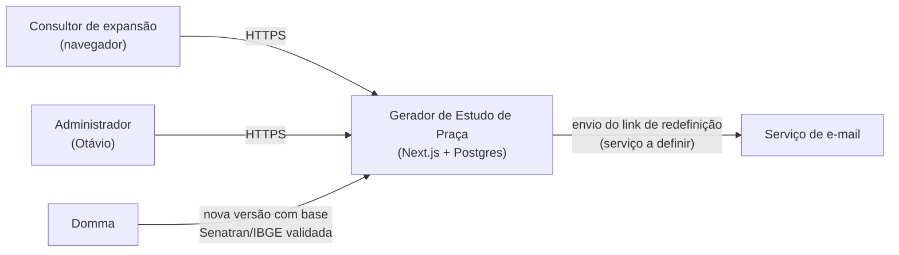
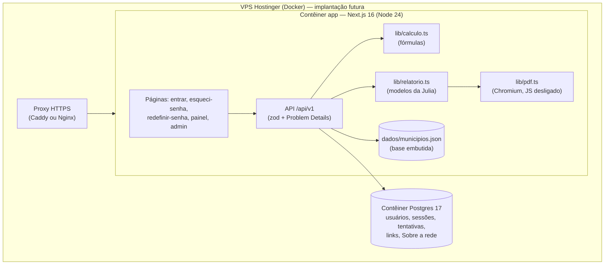
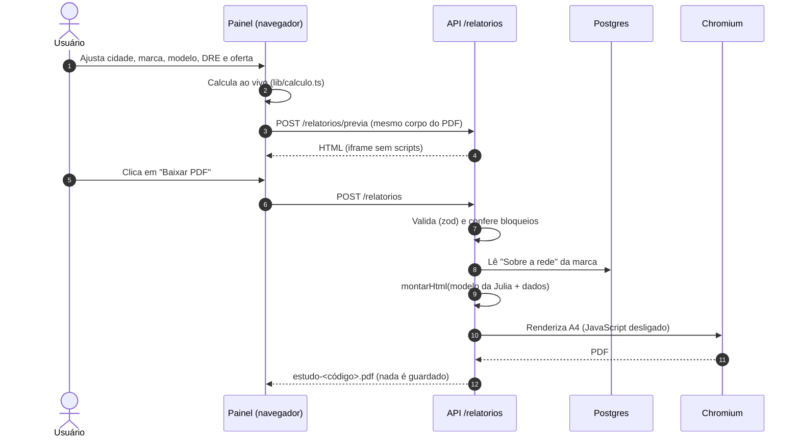
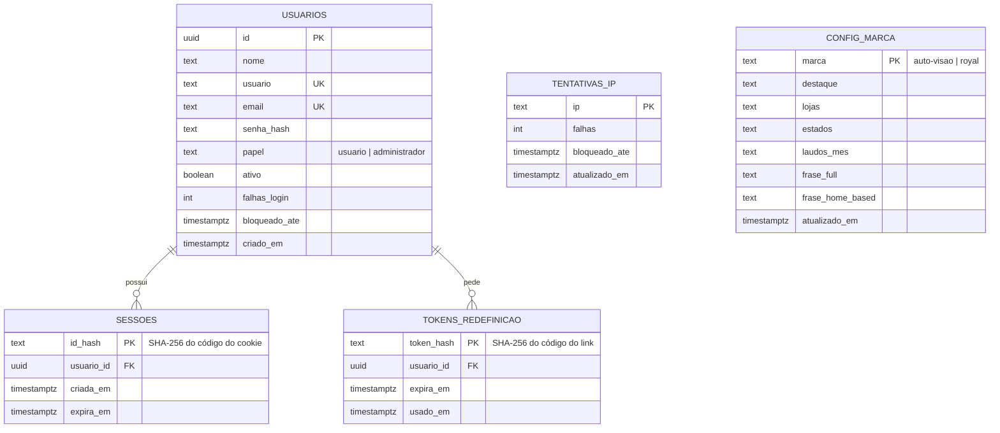
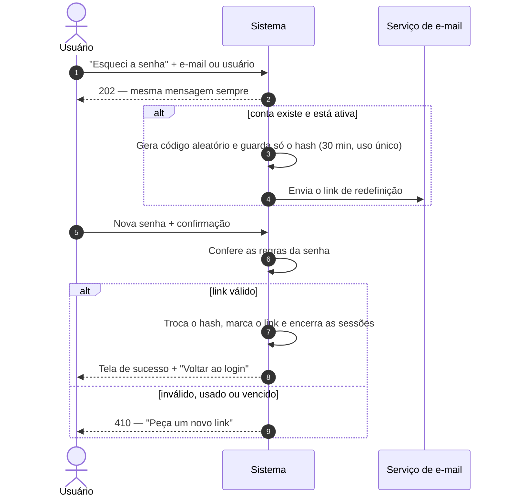

# Documentação técnica — Gerador de Estudo de Praça v2

## 1. Sobre este documento

| Item | Valor |
|---|---|
| Sistema | Gerador de Estudo de Praça v2 — Auto Visão e Royal Vistorias |
| Versão do sistema | 0.2.1 (implementação local) |
| Escopo de referência | Escopo final **v2.0** (29/10/2026) |
| Design de referência | `especificacao.md` v1.7, seção 16 (Julia, equipe do Caio) |
| Responsável | Domma Tecnologia — Otávio Marques |
| Situação | Implementado e testado **só no ambiente local**. Nada foi publicado, implantado, enviado a repositório remoto ou por e-mail. |

Este documento reúne o PRD resumido, a arquitetura, o modelo de dados, as fórmulas, a API, a segurança, os ADRs, os manuais, o guia de instalação e implantação, os testes, as pendências, o roteiro de desenvolvimento com o Claude Code e o histórico de mudanças. **Nenhuma senha ou chave aparece neste documento**; onde um segredo seria usado, aparece `<OCULTO>` ou `<SENHA>`.

## 2. PRD resumido

### 2.1 Problema
O gerador atual (site no Lovable) usa uma base com rótulo errado ("IBGE 2026"), gera um PDF de imagem de página única, não tem acesso controlado, não separa vistoria Detran e cautelar, não tem DRE e não atende o modelo Home Based. As equipes de expansão precisam de um estudo confiável, com fontes oficiais, no visual de cada marca.

### 2.2 Solução
Sistema novo, com login, que calcula na hora o potencial de vistorias de qualquer um dos 5.571 municípios e gera um **PDF A4 pesquisável** por marca e modelo, com DRE opcional, oferta de franquia editável, seção "Sobre a rede" e aviso fixo em todas as páginas.

### 2.3 Usuários e papéis
| Papel | Quem | Pode |
|---|---|---|
| Usuário | equipes de expansão | entrar, montar o estudo, baixar PDF/PNG |
| Administrador | Otávio | tudo do usuário + criar/desativar usuários, redefinir senhas, editar "Sobre a rede" |

### 2.4 Histórias de usuário
1. Como consultor de expansão, quero escolher a cidade e ver na hora laudos/mês e faturamento estimado, para apresentar ao candidato.
2. Como consultor, quero escolher a marca e o modelo (Full ou Home Based), para que o relatório saia no visual e no texto certos.
3. Como consultor, quero ligar o DRE e informar o volume da unidade, para mostrar um resultado mensal simulado.
4. Como administrador, quero criar e desativar usuários e editar os números da rede, sem depender da Domma.
5. Como usuário que esqueceu a senha, quero receber um link de uso único para criar uma nova.

### 2.5 Requisitos principais (MVP)
- **Funcionais:** busca de município; 3 cenários (1,5/2/2,5%); divisão 90/10; tickets R$ 147/R$ 280 editáveis; Home Based com laudos digitados; DRE opcional nos dois modelos; oferta editável com parcelamento opcional; PDF A4 (2 páginas sem DRE, 3 com DRE) e PNG; marca d'água e identificador lateral; "Sobre a rede" editável; login, bloqueio, "Esqueci a senha"; administração de usuários.
- **Não funcionais:** PDF em poucos segundos; texto pesquisável; nenhum estudo guardado (LGPD: só dados dos usuários internos); cabeçalhos de segurança; fidelidade visual às prévias aprovadas (≤ 1,2% de diferença por página).

### 2.6 Critérios de aceite (todos atendidos — ver capítulo 12)
- [x] Joinville/SC no cenário provável: 9.968 laudos/mês, 453/dia útil, R$ 1.597.897/mês, R$ 19.174.764/ano.
- [x] DRE com 400 laudos: receita bruta R$ 64.120,00; resultado R$ 38.783,80; margem 64,35%.
- [x] Home Based com 200 laudos: R$ 56.000/mês; PDF bloqueado com o campo vazio; sem "DETRAN", "credenci" nem "ECV".
- [x] Marcas nunca se misturam; aviso fixo em todas as páginas, mesmo texto nos dois modelos.
- [x] 5 senhas erradas bloqueiam por 10 minutos, mesmo com a senha certa depois.

### 2.7 Fora do escopo
Comparativo de cidades, geocodificação e raio; salvamento de estudos; ponto de equilíbrio e retorno; calibração com dados das unidades; carga automática da base (Fase 2); dados de concorrência, PIB e renda (Fase 2); Fenabrave e transferências por LAI (Fase 3).

## 3. Arquitetura

### 3.1 Contexto (C4 — nível 1)



### 3.2 Contêineres (C4 — nível 2)



### 3.3 Fluxo de geração do relatório



### 3.4 Decisões de arquitetura
- **Módulo profundo de cálculo:** toda regra numérica está em `lib/calculo.ts` (dinheiro do DRE em centavos inteiros), usada pela tela e pelo servidor.
- **Uma fonte para prévia e PDF:** `montarHtml` gera o HTML dos dois.
- **Visual por modelos:** os HTML/CSS da Julia são o modelo; o código só troca valores (ADR-0002).
- **Sem estado de estudo:** o banco não guarda estudos; o código do estudo é gerado na hora.

## 4. Modelo de dados



| Tabela | Finalidade | Regras no banco |
|---|---|---|
| `usuarios` | contas internas | `usuario` único e no formato `^[a-z0-9._-]{3,40}$`; e-mail único; papel restrito |
| `sessoes` | sessões ativas | só o hash; índice em `usuario_id`; apagadas em cascata |
| `tokens_redefinicao` | links de "Esqueci a senha" | só o hash; uso único (`usado_em`); índice em `usuario_id` |
| `tentativas_ip` | bloqueio por IP | 20 falhas → 10 min |
| `config_marca` | "Sobre a rede" | uma linha por marca; dados iniciais informados pelo Otávio (não verificados externamente) |
| `migracoes_aplicadas` | controle de migrações | — |

**Base embutida (`dados/municipios.json`):** `cod_ibge`, `nome`, `uf`, `nome_normalizado`, `populacao`, `frota_total` para 5.571 municípios (população total 213.421.037; frota 133.337.835). Fontes: Senatran — Frota por município e tipo — setembro/2026; Estimativa IBGE 2025 (referência 1º/07/2025). 36 grafias diferentes resolvidas em `dados/excecoes-nomes.json`.

## 5. Fórmulas e exemplo de Joinville

### 5.1 Potencial da cidade (modelo Full)
Parâmetros: frota $F$; percentual do cenário $p_c$ (conservador 1,5%, **provável 2%**, otimista 2,5%); divisão Detran $\delta$ = 90%; tickets $P_D$ = R$ 147 e $P_C$ = R$ 280; 22 dias úteis.

$$L_c = \operatorname{arred}(F \cdot p_c) \qquad L^{D}_c = \operatorname{arred}(L_c \cdot \delta) \qquad L^{C}_c = L_c - L^{D}_c$$

$$\text{dia útil} = \operatorname{arred}(L_c / 22) \qquad FB_c = L^{D}_c \cdot P_D + L^{C}_c \cdot P_C \qquad FB^{ano}_c = 12 \cdot FB_c$$

Indicadores opcionais (só com ECVs > 0): frota por ECV = arred($F$ ÷ ECVs); laudos por ECV = arred($L_c$ ÷ ECVs).

**Joinville/SC** — população 664.541; frota 498.378:

| Cenário | Laudos/mês | Dia útil | Detran | Cautelar | Faturamento mensal | Anual |
|---|---|---|---|---|---|---|
| Conservador (1,5%) | 7.476 | 340 | 6.728 | 748 | R$ 1.198.456 | R$ 14.381.472 |
| **Provável (2%)** | **9.968** | **453** | **8.971** | **997** | **R$ 1.597.897** | **R$ 19.174.764** |
| Otimista (2,5%) | 12.459 | 566 | 11.213 | 1.246 | R$ 1.997.191 | R$ 23.966.292 |

Conferência do provável: 498.378 × 2% = 9.967,56 → **9.968**; 9.968 × 90% = 8.971,2 → **8.971**; cautelar 9.968 − 8.971 = **997**; 8.971 × 147 = 1.318.737; 997 × 280 = 279.160; soma **1.597.897**.

### 5.2 Home Based
$$L = \text{laudos digitados} \qquad \text{dia útil} = \operatorname{arred}(L/22) \qquad FB = L \cdot P_{laudo} \qquad FB^{ano} = 12 \cdot FB$$

Sugestão de 180 a 250 laudos/mês (fora da faixa só sinaliza). Campo vazio **bloqueia o PDF**. Exemplo: 200 × R$ 280 = **R$ 56.000/mês**, **R$ 672.000/ano**, **9 por dia útil**.

### 5.3 DRE mensal (Full)
Volume da unidade $V$ (campo "Laudos/mês da unidade", sem padrão): $T$ = arred($V$ × δ), $C$ = $V$ − $T$.

| Linha | Fórmula | Exemplo (400 laudos = 360 + 40) |
|---|---|---|
| Receita bruta (RB) | $T \cdot P_D + C \cdot P_C$ | 52.920 + 11.200 = **R$ 64.120,00** |
| Impostos | 6% × RB | − R$ 3.847,20 |
| Receita líquida (RL) | RB − impostos | R$ 60.272,80 |
| Custo Detran | $T$ × R$ 0 | R$ 0,00 |
| Pesquisa cautelar | $C$ × R$ 25 | − R$ 1.000,00 |
| Marketing | $T$ × R$ 8 | − R$ 2.880,00 |
| Parcela da franquia | R$ 1.000 | − R$ 1.000,00 |
| Royalties | $(T+C)$ × R$ 8 | − R$ 3.200,00 |
| Custos variáveis | soma | **− R$ 8.080,00** |
| Funcionários | TETO($V$ ÷ 200), mínimo 1 | 2 |
| Pessoal | func. × R$ 1.700 × 1,5 | **− R$ 5.100,00** |
| Despesas fixas | aluguel 6.000; água 60; energia 250; internet 120; contabilidade 500; manutenção 250; material 100; impressões 150; filmagem 180; ouvidoria 59; ISO + seguros 390; gerais 250 | **− R$ 8.309,00** |
| **Resultado (EBITDA)** | RL − CV − pessoal − fixas | **R$ 38.783,80** |
| **Margem** | EBITDA ÷ RL | **64,35%** |

Os valores reproduzem o DRE de referência da Auto Visão (`dre-auto-visao.xlsx`, 10 colunas conferidas em teste). Todos os parâmetros são editáveis no painel.

### 5.4 DRE do Home Based
Mesma chave "Incluir DRE no relatório" (desligada por padrão). Receita = laudos × preço do laudo. **Começam zeradas** (confirmado pelo Otávio): custo Detran por vistoria, marketing por transferência, aluguel, água, energia, manutenção predial, sistema de filmagem, canal de ouvidoria, certificação ISO + seguros. **Marketing (R$/mês)** é um campo próprio que começa zerado e o Otávio preenche. Saem do demonstrativo as linhas de transferência e Detran.

Exemplo com 200 laudos × R$ 280 e os padrões: RB R$ 56.000; impostos R$ 3.360; RL R$ 52.640; CV R$ 7.600 (pesquisa 5.000 + parcela 1.000 + royalties 1.600); pessoal R$ 2.550 (1 funcionário); fixas R$ 1.120 (internet 120, contabilidade 500, material 100, impressões 150, gerais 250); **resultado R$ 41.370,00; margem 78,59%**.

### 5.5 Oferta de franquia
| Modelo | Valor | Entrada | Parcelas | Conferência |
|---|---|---|---|---|
| Full | R$ 30.000 | R$ 10.000 | 20 × R$ 1.000 | 10.000 + 20.000 = 30.000 ✔ |
| Home Based | R$ 15.000 | R$ 5.000 | 10 × R$ 1.000 | 5.000 + 10.000 = 15.000 ✔ |

Sem parcelamento, a linha de parcelas some. Se entrada + parcelas ≠ valor, o painel mostra um alerta que **não bloqueia** o PDF.

### 5.6 Código do estudo
`<AV|RV>-AAAAMMDD-HHMM-XXXX` no horário de Brasília (XXXX aleatório), impresso no identificador lateral de todas as páginas com data, hora e usuário. Não é guardado.

## 6. API

{{API}}

## 7. Segurança

### 7.1 Autenticação e sessões
- Senhas com **Argon2id** (memória 19 MiB, tempo 2, paralelismo 1). A senha nunca é registrada em log.
- Ao entrar, o servidor gera um código aleatório de 32 bytes, grava **só o SHA-256** em `sessoes` e envia o código no cookie `sessao` (**HttpOnly, SameSite=Lax, Secure** em produção). Validade: **12 horas**.
- "Sair" apaga a sessão. Trocar a senha encerra todas as sessões do usuário. Usuário desativado perde o acesso na hora.
- Mensagem única para usuário ou senha errados ("Usuário ou senha inválidos.").

### 7.2 Bloqueio por tentativas
- **5 senhas erradas** seguidas para o mesmo usuário → bloqueio de **10 minutos**, mesmo que a senha certa seja digitada depois (HTTP 429).
- **20 falhas** do mesmo IP → bloqueio do IP por 10 minutos.
- Contadores no Postgres (funcionam com mais de uma instância).

### 7.3 Recuperação de senha



No ambiente local o envio é **simulado**: o log registra só o domínio do destinatário. O serviço real é pendência de implantação.

### 7.4 Controles gerais
| Ameaça (STRIDE) | Controle |
|---|---|
| Falsificação de identidade | Argon2id, bloqueio por usuário e IP, sessões opacas, cookies HttpOnly/SameSite |
| Adulteração | validação zod em toda entrada; consultas parametrizadas; HTML do relatório com escape de todo texto digitado |
| Repúdio | identificador lateral com código, data/hora e usuário em cada página |
| Vazamento de informação | resposta igual no pedido de redefinição; erros genéricos (Problem Details) sem pilha; só hashes no banco; nenhum estudo guardado |
| Negação de serviço | limites de tentativas; tamanhos máximos nos campos |
| Elevação de privilégio | autorização por papel em toda rota de administração (401 sem sessão, 403 sem papel); o administrador não pode se desativar |
| Injeção no PDF | Chromium com JavaScript desligado; prévia em iframe sem scripts |

Cabeçalhos: `Content-Security-Policy` (`default-src 'self'`, `frame-ancestors 'none'`), HSTS, `X-Content-Type-Options: nosniff`, `Referrer-Policy`. Segredos só em variáveis de ambiente; o repositório tem apenas `.env.example` com `<SENHA>`.

## 8. Decisões de arquitetura (ADRs)

{{ADRS}}

## 9. Manual do usuário

### 9.1 Entrar
1. Abra o endereço do sistema. Informe **usuário ou e-mail** e **senha** (fornecidos pelo administrador) e clique em **Entrar**.
2. Depois de 5 senhas erradas, o acesso fica bloqueado por 10 minutos.


### 9.2 Esqueci a senha
1. Na tela de login, clique em **Esqueci a senha**, informe o e-mail de cadastro e clique em **Enviar link**. A mensagem é sempre a mesma, por segurança.
2. Abra o link recebido (vale 30 minutos e só uma vez), digite a nova senha duas vezes — mínimo de 8 caracteres, com maiúscula, minúscula e número — e confirme. Aparece a tela de sucesso com **Voltar ao login**.


### 9.3 Montar o estudo (Full)
1. No topo do painel, escolha o **modelo** (Full ou Home Based) e a **marca** (Auto Visão ou Royal).
2. Em **Praça**, digite o nome da cidade e escolha na lista. População e frota são preenchidas com a base oficial (editáveis). Informe as ECVs concorrentes, se souber.
3. Em **Cenário**, escolha conservador, provável ou otimista (percentuais editáveis). Ajuste a divisão Detran/cautelar e os tickets, se precisar.
4. Confira a **oferta de franquia** (valor, entrada, parcelamento). Se a conta não fechar, aparece um alerta, mas o PDF continua liberado.
5. O relatório à direita se atualiza na hora. Clique em **Baixar PDF** ou **Baixar PNG**.
6. O botão **Exemplo Joinville** preenche um exemplo completo (marcado como EXEMPLO); **Limpar** volta ao início.


### 9.4 Incluir o DRE
1. Abra a seção **DRE mensal** e ligue **Incluir DRE no relatório**.
2. No Full, informe os **laudos/mês da unidade** (sem padrão; varia por cidade). Com a chave ligada e o campo vazio, aparece um alerta e o PDF fica bloqueado.
3. Ajuste os custos campo a campo, se precisar; **Voltar aos padrões do modelo** restaura os valores da planilha.


### 9.5 Home Based
1. Escolha **Home Based**. O painel troca a divisão e o ticket Detran pelo campo **Laudos/mês** (sugestão 180–250) e pelo **preço do laudo** (R$ 280).
2. Sem os laudos/mês, o PDF fica bloqueado.
3. Com o DRE ligado, as despesas que não se aplicam começam zeradas; preencha o **Marketing (R$/mês)**, se houver.
4. O relatório tem 2 páginas sem DRE e 3 com DRE, e não cita DETRAN, credenciamento nem ECV.


### 9.6 Relatório gerado
Cada página traz a marca d'água, o identificador lateral (código, data/hora, usuário) e o aviso fixo. Exemplos reais em `docs/exemplos/` (8 PDFs).

{{EXEMPLOS}}

## 10. Manual do administrador

O administrador acessa **Administração** no topo do painel.


### 10.1 Usuários
1. **Criar:** preencha nome, usuário (minúsculas, 3 a 40 caracteres), e-mail e senha inicial (regras da senha) e clique em **Criar**. Entregue a senha ao usuário por um canal seguro e peça que ele a troque.
2. **Desativar / reativar:** o usuário desativado perde o acesso na hora. Não é possível desativar a própria conta.
3. **Redefinir senha:** define uma nova senha e encerra as sessões do usuário.

### 10.2 "Sobre a rede"
1. Para cada marca, edite destaque (opcional), lojas, estados, laudos por mês e as frases do Full e do Home Based.
2. Clique em **Salvar <marca>**. O próximo relatório já usa os novos valores.
3. Guarde a comprovação dos números e da frase de destaque (regras do CONAR). Os valores atuais foram informados pelo Otávio em 28/10/2026 e não foram verificados externamente.

### 10.3 Primeiro administrador e senha esquecida do administrador
O primeiro administrador é criado na implantação pela Domma com `npm run admin:criar -- <usuario> <email> "<Nome>"` (a senha é digitada sem eco e nunca aparece em log). O mesmo comando redefine a senha do administrador, se ele perder o acesso.

## 11. Instalação e implantação

### 11.1 Instalação local
Requisitos: Node 24, Docker, Google Chrome ou Chromium, Python 3 (só para regenerar a base e as comparações).

```bash
npm install
cp .env.example .env            # preencha <SENHA> com: openssl rand -hex 16
sudo docker compose up -d       # Postgres 17 na porta 5433
npm run db:migrate
npm run admin:criar -- otavio <email> "Otávio Marques"   # senha digitada sem eco
npm run build && npm start      # ou npm run dev → http://localhost:3000
```

| Variável | Obrigatória | Descrição |
|---|---|---|
| `DATABASE_URL` | sim | `postgres://estudo:<SENHA>@127.0.0.1:5433/estudo_praca` |
| `POSTGRES_PASSWORD` | sim (Docker) | senha do banco (aleatória) |
| `APP_URL` | sim | endereço público, base do link de redefinição |
| `COOKIE_SECURE` | não | `false` só no ambiente local sem HTTPS |
| `CHROME_PATH` | não | caminho do Chrome/Chromium |
| `EMAIL_SERVICO` | não | serviço de e-mail — **a definir** |

### 11.2 Implantação na VPS com Docker — guia (não executado)
> **Só com o OK explícito do Otávio.** Nada disto foi executado. Pendências: acesso à VPS, subdomínio e serviço de e-mail.

1. **Preparar a VPS (Hostinger):** atualizar o sistema; criar usuário sem privilégios para o deploy; firewall liberando só 22, 80 e 443; instalar Docker Engine e o plugin Compose.
2. **DNS:** criar o registro A do subdomínio escolhido apontando para o IP da VPS.
3. **Imagem da aplicação:** `Dockerfile` em duas etapas — (a) `node:24` com `npm ci` e `npm run build` (saída `standalone`); (b) `node:24-slim` com o Chromium instalado, usuário não root, `CHROME_PATH=/usr/bin/chromium`, copiando `.next/standalone`, `.next/static`, `public`, `modelos` e `dados`.
4. **Compose de produção:** serviços `app` (porta interna 3000), `db` (Postgres 17, volume persistente, sem porta exposta) e `proxy` (Caddy com HTTPS automático, ou Nginx + Certbot). Segredos num `.env` só na VPS (permissão 600), nunca no repositório.
5. **Variáveis:** `APP_URL=https://<subdomínio>`, `COOKIE_SECURE=true`, `DATABASE_URL` apontando para o serviço `db`, credenciais do serviço de e-mail.
6. **Primeira subida:** `docker compose up -d db` → `docker compose run --rm app npm run db:migrate` → `docker compose run --rm app npm run admin:criar -- ...` → `docker compose up -d`.
7. **Verificação:** rodar o teste de fumaça contra o subdomínio (`BASE=https://<subdomínio>`) e conferir um PDF de cada marca e modelo.
8. **Cópias de segurança:** `pg_dump` diário do banco para fora da VPS, com retenção de 30 dias; testar a restauração.
9. **Atualizações:** nova versão = nova imagem com etiqueta de versão; `docker compose pull && docker compose up -d`; migrações antes de subir a nova versão; manter a imagem anterior para voltar atrás.
10. **Operação:** logs com `docker compose logs`; atualizações de segurança da VPS mensais; renovação de certificado automática.

## 12. Testes e resultados

### 12.1 Estratégia
| Nível | Ferramenta | Cobre |
|---|---|---|
| Unitário | vitest (`tests/calculo.test.ts`) | fórmulas, cenários de Joinville, DRE contra o xlsx (10 colunas), regra de pessoal, royalties, Home Based, DRE do Home Based, marketing mensal, oferta, código do estudo |
| Unitário | vitest (`tests/relatorio.test.ts`) | relatório das 2 marcas × 2 modelos × com/sem DRE: páginas, números, aviso em todas as páginas, sem mistura de marcas, sem DETRAN no Home Based, parcelamento, escape de HTML, identificador lateral, bloqueios, validação de "Sobre a rede", regras de senha |
| Integração | `tests/integracao/fumaca.sh` | servidor real: login, busca, 8 PDFs (páginas e números via `pdftotext`), PNG, "Sobre a rede" (200/401), bloqueios, "Esqueci a senha", link inválido, bloqueio de 10 min |
| Visual | `scripts/comparar_previas.py`, `scripts/capturar_tela.py` | diferença de pixels contra as prévias aprovadas da Julia |
| Tipos | `tsc --noEmit` | sem erros |

### 12.2 Resultados (29/10/2026, ambiente local)

{{RESULTADOS}}

## 13. Desenvolvimento com Claude Code

O Otávio vai continuar o desenvolvimento no **Claude Code**. O repositório já traz um `CLAUDE.md` na raiz com a visão, a pilha, os comandos, a estrutura, as **regras invioláveis**, as fórmulas e os números de Joinville e os caminhos das referências. O Claude Code lê esse arquivo automaticamente ao abrir a pasta.

### 13.1 Como usar o código atual como ponto de partida
1. **Copie a pasta** `estudo-praca-v2/` inteira para o computador de desenvolvimento (sem `node_modules`, `.next` e `.env`). Copie também, ao lado, a pasta `estudo-praca/` (escopo, `design/`, `bases/`, `referencias/`), porque o `CLAUDE.md` aponta para ela.
2. **Crie um repositório git local** (`git init`, primeiro commit). Confira que `.env` está no `.gitignore` antes do primeiro commit. Não envie a repositório remoto sem o OK do Otávio.
3. **Gere um `.env` novo** a partir do `.env.example`, com senhas aleatórias próprias (as do ambiente da Domma não são reaproveitadas).
4. Rode `npm install`, suba o banco, `npm run db:migrate`, crie o administrador e rode `npm test` — o ponto de partida tem **62 testes passando**; esse é o "verde" de referência.
5. Abra o Claude Code na pasta e cole o prompt da Fase 0.

> Regra de ouro para todas as fases: **teste primeiro**; ao final de cada fase, `npm test`, `npm run typecheck` e `npm run build` precisam passar; commit local com mensagem clara. Os números de Joinville da seção 5 nunca podem mudar sem decisão do Otávio.

### 13.2 Roteiro em fases (prompts prontos para colar)

**Fase 0 — Reconhecimento e ambiente**

```text
Leia o CLAUDE.md, o escopo final v2.0 (seções 7, 9 e 13) e docs/openapi.yaml. Não altere nada ainda.
1) Rode npm install, npm run typecheck, npm test e npm run build e me mostre o resumo.
2) Liste os módulos (lib/, app/api/v1, components/) com uma frase cada.
3) Liste as pendências abertas do escopo (seção 13) e diga quais dependem de mim.
Não publique, não implante e não envie nada para repositório remoto.
```
*Pronto quando:* os 4 comandos passam (62 testes) e o resumo bate com o `CLAUDE.md`. *Testes:* `npm test`, `npm run typecheck`, `npm run build`.

**Fase 1 — Banco e administrador local**

```text
Suba o Postgres com docker compose, rode npm run db:migrate e me peça para criar o administrador com npm run admin:criar (eu digito a senha; nunca a escreva em arquivo nem em log). Depois rode o servidor e o teste de integração tests/integracao/fumaca.sh com SENHA_ARQ apontando para um arquivo que eu criar fora do repositório.
```
*Pronto quando:* login funciona e o teste de fumaça termina com `falhas: 0`. *Testes:* `fumaca.sh` (48 verificações).

**Fase 2 — Ajustes de cálculo (quando o Otávio decidir)**

```text
Implemente a decisão: <descreva a decisão do Otávio, ex.: confirmar o arredondamento por tipo ou mudar um padrão>.
Primeiro escreva o teste em tests/calculo.test.ts que falha, depois altere só lib/calculo.ts.
Os números de Joinville do CLAUDE.md (9.968 / 453 / R$ 1.597.897 / R$ 38.783,80 / 64,35% / R$ 56.000 / R$ 41.370) devem continuar passando, salvo se a decisão mudar um deles — nesse caso, me mostre o antes e depois.
Atualize o CHANGELOG e o escopo (seção 7).
```
*Pronto quando:* teste novo vermelho → verde; todos os testes antigos verdes. *Testes:* `npm test`, `npm run typecheck`.

**Fase 3 — Relatório (textos "[REVISAR – OTÁVIO]" e novos modelos da Julia)**

```text
Troque os textos marcados [REVISAR – OTÁVIO] em modelos/relatorio/<marca>/ pelos textos aprovados: <cole os textos>.
Se a Julia entregou novos HTML, copie-os para modelos/relatorio/<marca>/ sem redesenhar e ajuste só as substituições em lib/relatorio.ts.
Nunca misture as marcas, mantenha o aviso fixo em todas as páginas e o Home Based sem DETRAN/credenciamento/ECV.
Rode npx tsx scripts/gerar-exemplos.ts e python3 scripts/comparar_previas.py e me mostre a tabela de diferenças.
```
*Pronto quando:* testes de relatório verdes; diferença para as prévias ≤ 1,5% por página (exceto onde o texto mudou de propósito). *Testes:* `npm test`, comparação visual, `fumaca.sh`.

**Fase 4 — Tela e administração**

```text
Implemente na tela: <ajuste pedido>. A tela vem de modelos/tela/painel.html, gerado por scripts/montar_tela.py a partir do design/tela da Julia; altere o script, não o HTML gerado. A lógica fica em components/tela/painel.ts e os cálculos em lib/calculo.ts.
Rode scripts/capturar_tela.py e me mostre as imagens de comparação.
```
*Pronto quando:* a comparação da tela fica no mesmo patamar (≤ 8% nos estados com mais campos que a prévia); testes verdes. *Testes:* `npm test`, `capturar_tela.py`, `fumaca.sh`.

**Fase 5 — Serviço de e-mail do "Esqueci a senha"**

```text
O Otávio escolheu o serviço de e-mail <nome>. Implemente enviarEmailRedefinicao em lib/auth.ts usando variáveis de ambiente (nunca chaves no código), com texto em português e o link de 30 minutos. Adicione as variáveis ao .env.example com valores fictícios e um teste que simula o envio sem rede. Não envie e-mail real sem o meu OK.
```
*Pronto quando:* teste do envio simulado passa; nenhuma chave no repositório (`git grep` limpo). *Testes:* `npm test`, `fumaca.sh` (pedido de link 202).

**Fase 6 — Empacotamento para produção**

```text
Crie o Dockerfile de produção (duas etapas, usuário não root, Chromium, saída standalone) e o docker-compose.producao.yml (app, db sem porta exposta, proxy Caddy com HTTPS), seguindo o capítulo 11.2 da documentação técnica. Teste localmente com docker compose -f docker-compose.producao.yml up e rode o fumaca.sh contra ele. Não implante na VPS.
```
*Pronto quando:* a imagem sobe localmente, gera PDF das 2 marcas e o teste de fumaça passa. *Testes:* `fumaca.sh` contra o contêiner.

**Fase 7 — Implantação (só com o OK do Otávio)**

```text
O Otávio autorizou a implantação na VPS <IP/host> no subdomínio <subdomínio>. Siga o capítulo 11.2 passo a passo, me mostrando cada comando antes de executar. Segredos só no .env da VPS (permissão 600). Ao final, rode o fumaca.sh contra https://<subdomínio> e configure o pg_dump diário.
```
*Pronto quando:* HTTPS ativo, login, PDF das 2 marcas × 2 modelos, teste de fumaça com 0 falhas, cópia de segurança testada. *Testes:* `fumaca.sh` em produção, restauração do `pg_dump`.

### 13.3 Boas práticas no Claude Code
- Peça **um passo por vez** e exija o teste antes do código.
- Sempre que mudar a API, peça para atualizar `docs/openapi.yaml`; decisões caras viram ADR em `docs/adr/`.
- Ao fim de cada fase: `npm test && npm run typecheck && npm run build`, CHANGELOG atualizado e commit local.
- Nunca cole senhas ou chaves no chat; use arquivos fora do repositório (como o `SENHA_ARQ`).

## 14. Pendências

| Código | Pendência | Bloqueia |
|---|---|---|
| A1 | Serviço de envio de e-mail do "Esqueci a senha" (hoje simulado) | publicação |
| A2 | Implantação na VPS Hostinger (acesso e OK do Otávio) | publicação |
| A3 | Domínio/subdomínio | publicação |
| B1 | PB Santarém → Joca Claudino [A CONFIRMAR] | não |
| B2 | RN Boa Saúde → Januário Cicco [A CONFIRMAR] | não |
| B3 | Exportar o `municipios_2026.json` do site atual | não |
| B4 | Sufixo do arquivo IBGE e formato da Senatran a cada carga [A CONFIRMAR] | não |
| C1–C6 | Propostas já implementadas aguardando o OK do Otávio: arredondamento por tipo; sessão 12 h / 5 tentativas / 20 por IP / link 30 min; usuário no identificador lateral; faixas dos textos automáticos; frota total; linha de premissas do modelo da Julia | não |
| C7 | Textos "[REVISAR – OTÁVIO]" nos modelos da Julia | não |
| C8 | Página do DRE do Home Based sem modelo próprio da Julia (reaproveita a do Full) | não |
| D1–D3 | Fases seguintes: nota 0–100; LAI/Fenabrave; renda (SIDRA) e ECVs de outros estados | não |

## 15. Histórico de mudanças (CHANGELOG)

{{CHANGELOG}}
